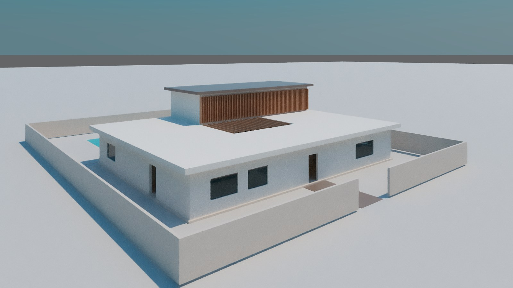
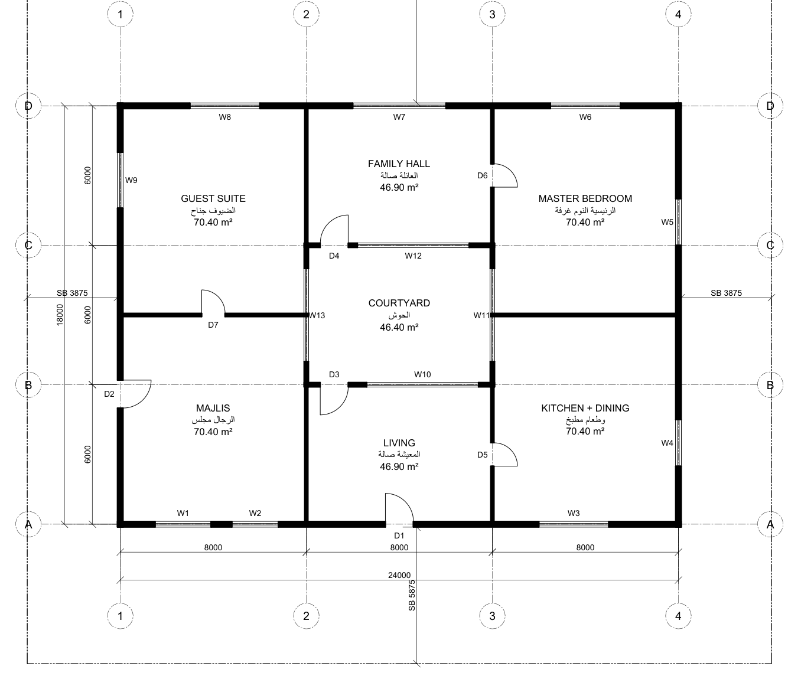
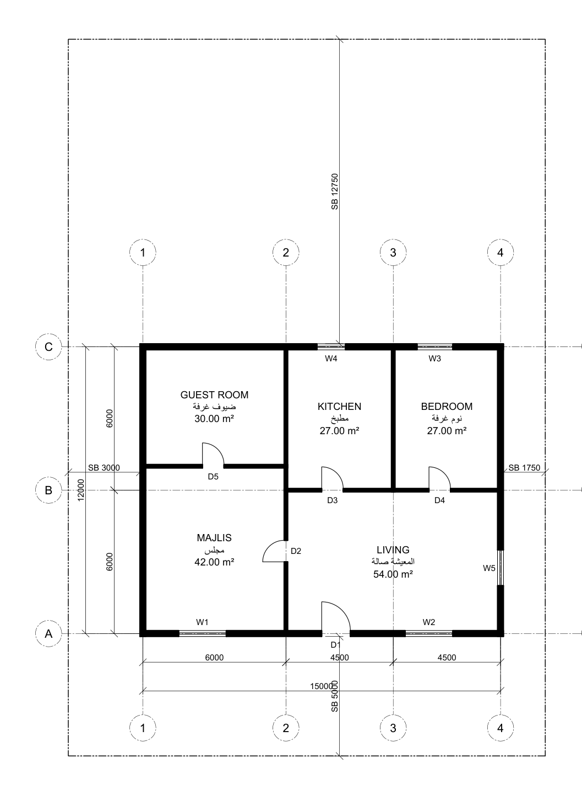
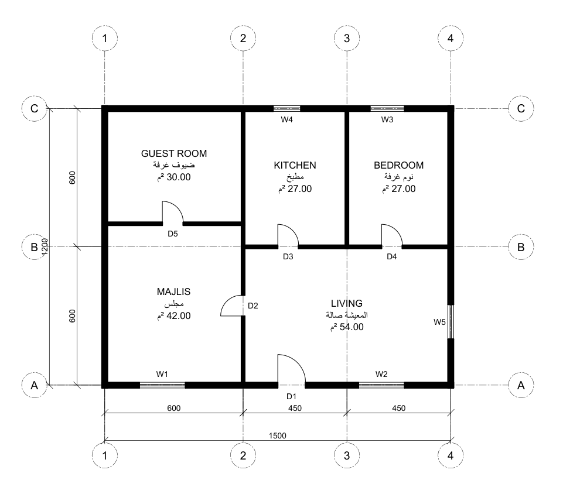
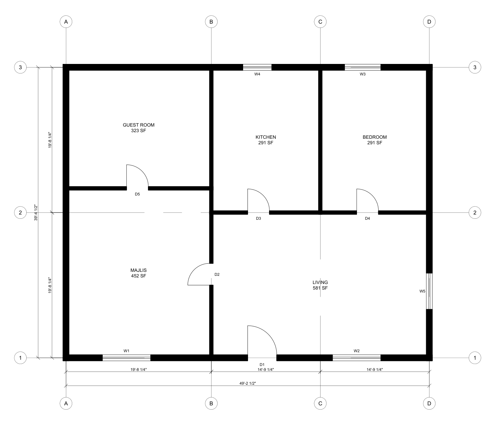

# building-skill — AutoCAD · Revit · BIM · MEP skill for Claude

**Free, open-source Claude skill that draws buildings the way each country actually requires.**
Architecture, structure, MEP (HVAC, plumbing, drainage, electrical, fire), civil/site and renders, in
AutoCAD (incl. MEP / Electrical / Mechanical), Revit, SketchUp, 3ds Max, IFC/openBIM and plain DXF/DWG.

> سكيل مجاني لـ Claude يرسم المباني على طريقة كل دولة: أوتوكاد، ريفت، سكتش أب، 3ds Max، BIM، تكييف وكهرباء وصحي وحريق — بالعربي والإنجليزي، مع اشتراطات قطر والسعودية والإمارات ومصر وغيرها.

## Why this exists

Ask any AI for "a villa plan in Doha" and you get US layer names, guessed setbacks and an invented law number.
This skill fixes that. Tested head-to-head (same task, with and without the skill):

| | Without skill | With building-skill |
|---|---|---|
| Layers / units | US standard for every country | Each country's own (mm, cm, m, ft-in) |
| Setbacks | Guessed | Cited from official text (e.g. Qatar Ministerial Decision 108/2026), or "get it from <authority>" |
| Law numbers | Invented | Only from the reference files |
| Questions asked | None | Zone, street width, frontage, authority |
| Output checked | Never | Opened in real AutoCAD: AUDIT 0 errors, DWG + PDF |

## What it does

- **Asks the right questions first** — country, city, zone, plot, street width — and writes assumptions on the sheet when you can't answer.
- **Country-correct drawings** — units, dimension format, layer standard, bilingual Arabic/English title blocks, sheet sizes, north arrow, grids.
- **Automatic code check on the sheet** — setbacks and coverage printed as PASS/FAIL with the source cited.
- **Works with or without the apps** — live MCP (Revit/AutoCAD/SketchUp/3ds Max), headless (AutoCAD Core Console, 3dsmaxbatch, Blender) or offline DXF/IFC.
- **Renders** — 3ds Max scene from the same plan, real sun position for the site.
- **References** — detailed files for 16+ countries (Qatar, Saudi Arabia, UAE, Egypt, Kuwait, Oman, Bahrain, Jordan, Morocco, Turkey, USA, UK, Germany, France, Spain, Italy, …), an index of 197 countries, and method guides for every discipline and app.

## Examples

**Doha courtyard villa** — one JSON brief → AutoCAD sheet + 3ds Max render ([spec](examples/doha-courtyard-villa.json)):





The sheet carries its own code check. On the first try it caught the designer's mistake — side setbacks of 2.875 m against Qatar's 3 m — and printed `FAIL` until the plot was fixed:

```
CODE CHECK (QA Decision 108/2026 Annex 7 (villa))
SOUTH front setback 5875 >= 5000: PASS
WEST side setback 3875 >= 3000: PASS
EAST side setback 3875 >= 3000: PASS
Coverage 34.6 % <= 60 %: PASS
```

Same plan, three countries:

| Qatar (mm, bilingual) | Egypt (cm dims) | USA (feet-inches, ARCH D) |
|---|---|---|
|  |  |  |

All produced by the skill's scripts and verified in AutoCAD 2026 (AUDIT: 0 errors) and 3ds Max 2026. Built together with Claude (Anthropic) — the skill was written, tested and debugged by Claude Code running it against the real apps.

## Install

**Claude Code**
```
/plugin marketplace add mostafamahereid1946-spec/claude-building-skill
/plugin install building-skill@building-skill
```

**Any agent (Claude Code, Codex, Cursor, …)**
```
npx skills add mostafamahereid1946-spec/claude-building-skill
```

**claude.ai** — download `building-skill.zip` from Releases → Settings → Capabilities → Skills → upload. Code execution must be on.

Scripts need [uv](https://docs.astral.sh/uv/) (it fetches Python and ezdxf automatically). AutoCAD/3ds Max are optional.

## Try it

> "Draw the ground floor of a 2-storey villa on a 20 × 30 m plot in Al Waab, Doha — majlis, guest room, living, kitchen, bedroom. Check the setbacks."

> "ارسم مسقط دور أرضي لفيلا في التجمع الخامس على قطعة 20×30 مع مجلس وصالة ومطبخ، وراجع الردود."

## Honest limits

- Code numbers marked ⚠ in the references are unverified against the official text — the skill tells you to confirm them with the authority. Local rules (zoning, plot affection plans) always win.
- Revit LT has no API, so it can't be automated; the skill delivers IFC/DWG for import instead.
- This is a drafting assistant, not a licensed engineer. A licensed professional must check and stamp anything you submit.

## Contributing

Add a country: copy `skills/building-skill/references/countries/qa.md`'s section layout, cite every number, mark unverified ones ⚠, and add a profile in `scripts/profiles/` (use `"extends"`). PRs with official-source corrections are the most valuable contribution.

## License

MIT
