# Parametric shopping malls - 28 countries

Generated by `scripts/gen_mall.py` (plan spec per level) + `scripts/mep_overlay.py` (MEP layers) from the country profiles.
Nothing here is a design for construction: **sample projects**. Every number is either cited from `references/countries/<cc>.md`
(✓ read; ⚠ = marked "verify" in that file, or an assumption) or a rule of thumb (RoT).

```bash
bash examples/malls/build_all.sh [cc ...]      # repo root: gen_mall -> dxf_plan -> mep_overlay -> plan_audit -> ifc_from_spec
uv run -q skills/architecture-mep-bim/scripts/gen_mall.py --country qa --out examples/malls/qa [--levels 2] [--plot 120x90]
```

**Layout (all countries, default plot 120 x 90 m, front = south).** Structural grid 8.4 m [RoT, structural.md 3]; double-loaded mall street 12 m with a
central atrium (void on L1, glass roof); shops 8.4 x 21 m; service corridor 4.2 m behind both rows, 2+ exterior exits per segment;
two anchor stores (2 bays x 62.4 m) at the street ends; south entrance lobby with lifts; north centre: loading bay, MDB + fire pump/tank,
AHU + generator, WC blocks (men / women / accessible) and, in Muslim-majority countries (qa ae sa kw om bh jo ma eg tr my pk),
prayer rooms men/women (design-concepts.md 6.6, RoT); escape-stair cores (stair + exit passage + electrical and mechanical/plumbing risers); L1 food court over the lobby.
Egress: the max walking distance (path around the atrium void, open-plan rooms) to the nearest final exit or protected-stair door is computed;
the generator adds stair cores until it is <= the country limit. Rooms are labelled in Arabic where the profile is bilingual (qa ae sa kw om bh jo ma eg).

**MEP overlay** (layers `M-` `E-` `P-` `FP-` + `A-FLOR-*` details, legend block in paper space): sprinkler heads on an adaptive grid <= 2.8 m
(NFPA 13 OH2 12.1 m2 / 4.6 m; EN 12845 OH 12 m2 / 4.0 m for uk de fr es it; mep.md 4.1), smoke/heat detectors on a 9.0 m grid (mep.md 4.3),
call points, hose reels/FHC and exit signs at exits and stairs (mep.md 4.2), supply diffusers <= 3.0 m grid per shop (mep.md 1.5), supply-duct main
in each service corridor + shop take-offs, DB per shop + MDB + feeder tray, luminaire grid in the mall street, WC fixtures with stacks. Indicative only: no hydraulic, duct or load calculation.

## Summary

| Country | Profile | Shops GF / L1 | Travel limit (m) | Max computed GF / L1 (m) | plan_audit GF | plan_audit L1 | AutoCAD 2026 | Render |
|---|---|---|---|---|---|---|---|---|
| [ae](#ae) | United Arab Emirates | 7 / 11 | 45 ⚠ verify | 42.1 / 42.1 | 0 FAIL / 0 WARN | 0 FAIL / 0 WARN | - | - |
| [au](#au) | Australia | 6 / 10 | 40 ⚠ verify | 33.5 / 38.0 | 0 FAIL / 0 WARN | 0 FAIL / 0 WARN | - | - |
| [bh](#bh) | Bahrain | 7 / 11 | 45 ⚠ verify | 42.1 / 42.1 | 0 FAIL / 0 WARN | 0 FAIL / 0 WARN | - | - |
| [br](#br) | Brazil | 7 / 11 | 45 ⚠ verify | 42.1 / 42.1 | 0 FAIL / 0 WARN | 0 FAIL / 0 WARN | - | - |
| [ca](#ca) | Canada | 7 / 11 | 45 ⚠ verify | 42.1 / 42.1 | 0 FAIL / 0 WARN | 0 FAIL / 0 WARN | - | - |
| [cn](#cn) | China | 7 / 11 | 45 ⚠ verify | 42.1 / 42.1 | 0 FAIL / 0 WARN | 0 FAIL / 0 WARN | - | - |
| [de](#de) | Germany | 5 / 9 | 35 ✓ | 33.5 / 33.5 | 0 FAIL / 0 WARN | 0 FAIL / 0 WARN | GF + GF-MEP: AUDIT_ERRORS=0 | yes |
| [eg](#eg) | Egypt | 7 / 11 | 45 ⚠ verify | 42.1 / 42.1 | 0 FAIL / 0 WARN | 0 FAIL / 0 WARN | GF + GF-MEP: AUDIT_ERRORS=0 | yes |
| [es](#es) | Spain | 7 / 11 | 50 ⚠ verify | 42.1 / 42.1 | 0 FAIL / 0 WARN | 0 FAIL / 0 WARN | - | - |
| [fr](#fr) | France | 7 / 11 | 45 ⚠ verify | 42.1 / 42.1 | 0 FAIL / 0 WARN | 0 FAIL / 0 WARN | - | - |
| [in](#in) | India | 7 / 11 | 45 ⚠ verify | 42.1 / 42.1 | 0 FAIL / 0 WARN | 0 FAIL / 0 WARN | - | - |
| [it](#it) | Italy | 7 / 11 | 45 ⚠ verify | 42.1 / 42.1 | 0 FAIL / 0 WARN | 0 FAIL / 0 WARN | - | - |
| [jo](#jo) | Jordan | 7 / 11 | 45 ⚠ verify | 42.1 / 42.1 | 0 FAIL / 0 WARN | 0 FAIL / 0 WARN | - | - |
| [jp](#jp) | Japan | 7 / 11 | 50 ✓ | 42.1 / 42.1 | 0 FAIL / 0 WARN | 0 FAIL / 0 WARN | - | - |
| [kw](#kw) | Kuwait | 7 / 11 | 45 ⚠ verify | 42.1 / 42.1 | 0 FAIL / 0 WARN | 0 FAIL / 0 WARN | - | - |
| [ma](#ma) | Morocco | 7 / 11 | 45 ⚠ verify | 42.1 / 42.1 | 0 FAIL / 0 WARN | 0 FAIL / 0 WARN | - | - |
| [mx](#mx) | Mexico | 8 / 12 | 60 ⚠ verify | 42.1 / 51.6 | 0 FAIL / 0 WARN | 0 FAIL / 0 WARN | - | - |
| [my](#my) | Malaysia | 8 / 12 | 60 ⚠ verify | 42.1 / 51.6 | 0 FAIL / 0 WARN | 0 FAIL / 0 WARN | - | - |
| [ng](#ng) | Nigeria | 7 / 11 | 45 ⚠ verify | 42.1 / 42.1 | 0 FAIL / 0 WARN | 0 FAIL / 0 WARN | - | - |
| [om](#om) | Oman | 7 / 11 | 45 ⚠ verify | 42.1 / 42.1 | 0 FAIL / 0 WARN | 0 FAIL / 0 WARN | - | - |
| [pk](#pk) | Pakistan | 7 / 11 | 45 ⚠ verify | 42.1 / 42.1 | 0 FAIL / 0 WARN | 0 FAIL / 0 WARN | - | - |
| [qa](#qa) | Qatar | 8 / 12 | 76 ⚠ verify | 42.1 / 51.6 | 0 FAIL / 0 WARN | 0 FAIL / 0 WARN | GF + GF-MEP: AUDIT_ERRORS=0 | yes |
| [sa](#sa) | Saudi Arabia | 8 / 12 | 76 ⚠ verify | 42.1 / 51.6 | 0 FAIL / 0 WARN | 0 FAIL / 0 WARN | - | - |
| [sg](#sg) | Singapore | 7 / 11 | 45 ⚠ verify | 42.1 / 42.1 | 0 FAIL / 0 WARN | 0 FAIL / 0 WARN | - | - |
| [tr](#tr) | Turkey | 7 / 11 | 45 ⚠ verify | 42.1 / 42.1 | 0 FAIL / 0 WARN | 0 FAIL / 0 WARN | - | - |
| [uk](#uk) | United Kingdom | 7 / 11 | 45 ⚠ verify | 42.1 / 42.1 | 0 FAIL / 0 WARN | 0 FAIL / 0 WARN | - | - |
| [us](#us) | United States | 8 / 12 | 76.2 ⚠ verify | 42.1 / 51.6 | 0 FAIL / 0 WARN | 0 FAIL / 0 WARN | GF + GF-MEP: AUDIT_ERRORS=0 | yes |
| [za](#za) | South Africa | 7 / 11 | 45 ⚠ verify | 42.1 / 42.1 | 0 FAIL / 0 WARN | 0 FAIL / 0 WARN | - | - |

Travel limit flag: ✓ = number read from an official text in the country file; ⚠ = the file marks it verify / table parsed / default 45 m used because the file gives no number.
Size budget: qa eg us de keep DXF/DWG/PDF/IFC (GF.dxf plain; L1 DXFs - and GF-MEP.dxf except qa - in `extra-dxf.zip`); every other country keeps `dxf-ifc.zip` (GF.dxf, GF-MEP.dxf, GF.ifc). `build_all.sh` regenerates everything.

## Per country

### ae

**United Arab Emirates** - sheet 1:250 @ A1, floor-to-floor GF 5000 mm / upper 4500 mm, footprint 109.2 x 62.4 m on a 120 x 90 m plot (coverage 63.1 %).

| Plan GF | MEP GF |
|---|---|
|  |  |

| Item | Value used | Source / status |
|---|---|---|
| Travel distance to exit (sprinklered) | <= 45 m; computed max GF 42.1 m, L1 42.1 m; stairs per level 3; exterior exit doors GF 29 | default 45 m sprinklered - number not in country file (verify with authority) ⚠ verify |
| Setbacks front / side / rear | 0 / 3 / 3 m (sheet code check: PASS) | ae.md 5.1 DBC Table B.1: 3 m from neighbour, 0 m road side ✓ |
| Escape stair / exit route clear width | >= 1200 mm (doors, passages, corridors) | ae.md 5.3 stair clear width 1200 mm (DBC B.6) ✓ |
| Parking | required 264 bays (GLA 6593 m2 / 25 m2 per bay); 45 surface bays drawn as ground massing | rule of thumb 4 bays per 100 m2 GLA ⚠ verify; balance not modelled |
| GF height | 5000 mm | rule of thumb 4.5-5.5 m GF floor-to-floor ⚠ verify |
| Sprinklers | NFPA 13 OH2: <= 12.1 m2 and 4.6 m per head | references/disciplines/mep.md 4.1; grid 2.8 m is RoT |
| plan_audit | GF: 7 pass / 0 warn / 0 fail; L1: 7 pass / 0 warn / 0 fail | scripts/plan_audit.py |
| Files | GF-MEP.png, GF-audit.txt, GF-plan.png, GF.json, L1-audit.txt, L1.json, dxf-ifc.zip, ifc.txt, mall.json | |

### au

**Australia** - sheet 1:250 @ A1, floor-to-floor GF 5000 mm / upper 4500 mm, footprint 109.2 x 62.4 m on a 120 x 90 m plot (coverage 63.1 %).

| Plan GF | MEP GF |
|---|---|
| 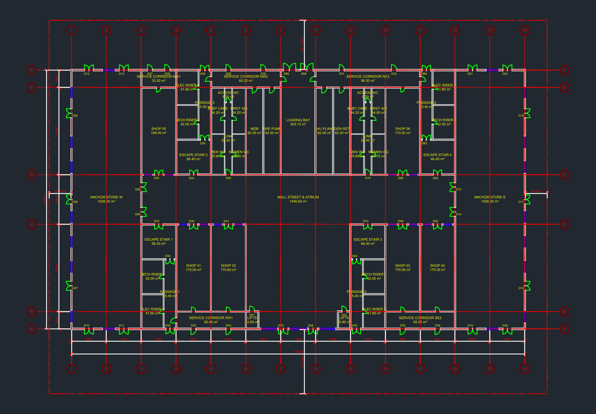 | 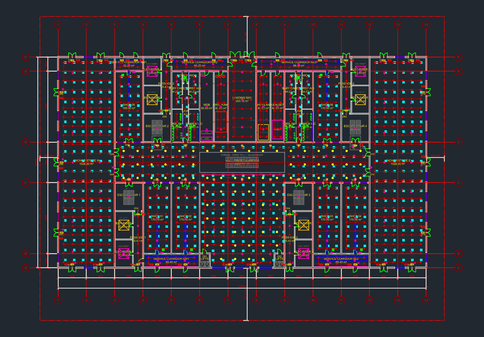 |

| Item | Value used | Source / status |
|---|---|---|
| Travel distance to exit (sprinklered) | <= 40 m; computed max GF 33.5 m, L1 38.0 m; stairs per level 4; exterior exit doors GF 32 | au.md 5 max 40 m to alternate exits (apartment figure from memory) ⚠ verify |
| Setbacks front / side / rear | 5 / 3 / 3 m (sheet code check: PASS) | ASSUMED 5/3/3 m - no commercial-zone setbacks in country file ⚠ verify |
| Escape stair / exit route clear width | >= 1200 mm (doors, passages, corridors) | rule of thumb 1200 mm clear ⚠ verify |
| Parking | required 251 bays (GLA 6251 m2 / 25 m2 per bay); 45 surface bays drawn as ground massing | rule of thumb 4 bays per 100 m2 GLA ⚠ verify; balance not modelled |
| GF height | 5000 mm | rule of thumb 4.5-5.5 m GF floor-to-floor ⚠ verify |
| Sprinklers | NFPA 13 OH2: <= 12.1 m2 and 4.6 m per head | references/disciplines/mep.md 4.1; grid 2.8 m is RoT |
| plan_audit | GF: 7 pass / 0 warn / 0 fail; L1: 7 pass / 0 warn / 0 fail | scripts/plan_audit.py |
| Files | GF-MEP.png, GF-audit.txt, GF-plan.png, GF.json, L1-audit.txt, L1.json, dxf-ifc.zip, ifc.txt, mall.json | |

### bh

**Bahrain** - sheet 1:250 @ A1, floor-to-floor GF 5000 mm / upper 4500 mm, footprint 109.2 x 62.4 m on a 120 x 90 m plot (coverage 63.1 %).

| Plan GF | MEP GF |
|---|---|
|  |  |

| Item | Value used | Source / status |
|---|---|---|
| Travel distance to exit (sprinklered) | <= 45 m; computed max GF 42.1 m, L1 42.1 m; stairs per level 3; exterior exit doors GF 29 | default 45 m sprinklered - number not in country file (verify with authority) ⚠ verify |
| Setbacks front / side / rear | 5 / 3 / 3 m (sheet code check: PASS) | ASSUMED 5/3/3 m - no commercial-zone setbacks in country file ⚠ verify |
| Escape stair / exit route clear width | >= 1200 mm (doors, passages, corridors) | rule of thumb 1200 mm clear ⚠ verify |
| Parking | required 132 bays (GLA 6593 m2 / 50 m2 per bay); 45 surface bays drawn as ground massing | bh.md 5.4 commercial/services 2 bays per 100 m2 (Art. 13, 20) ✓; balance not modelled |
| GF height | 5000 mm | rule of thumb 4.5-5.5 m GF floor-to-floor ⚠ verify |
| Sprinklers | NFPA 13 OH2: <= 12.1 m2 and 4.6 m per head | references/disciplines/mep.md 4.1; grid 2.8 m is RoT |
| plan_audit | GF: 7 pass / 0 warn / 0 fail; L1: 7 pass / 0 warn / 0 fail | scripts/plan_audit.py |
| Files | GF-MEP.png, GF-audit.txt, GF-plan.png, GF.json, L1-audit.txt, L1.json, dxf-ifc.zip, ifc.txt, mall.json | |

### br

**Brazil** - sheet Escala 1:250, floor-to-floor GF 5000 mm / upper 4500 mm, footprint 109.2 x 62.4 m on a 120 x 90 m plot (coverage 63.1 %).

| Plan GF | MEP GF |
|---|---|
|  | 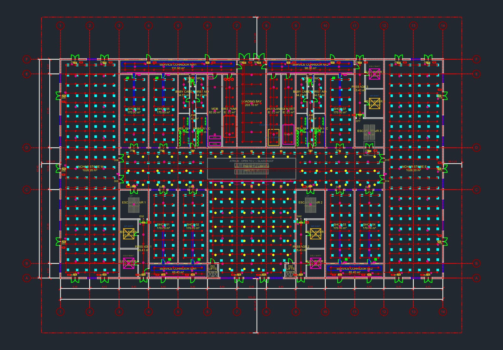 |

| Item | Value used | Source / status |
|---|---|---|
| Travel distance to exit (sprinklered) | <= 45 m; computed max GF 42.1 m, L1 42.1 m; stairs per level 3; exterior exit doors GF 29 | default 45 m sprinklered - number not in country file (verify with authority) ⚠ verify |
| Setbacks front / side / rear | 5 / 3 / 3 m (sheet code check: PASS) | ASSUMED 5/3/3 m - no commercial-zone setbacks in country file ⚠ verify |
| Escape stair / exit route clear width | >= 1200 mm (doors, passages, corridors) | br.md 5.2 minimum exit width 1.20 m (PR NPT 011 / SP IT-11) ✓ |
| Parking | required 264 bays (GLA 6593 m2 / 25 m2 per bay); 45 surface bays drawn as ground massing | rule of thumb 4 bays per 100 m2 GLA ⚠ verify; balance not modelled |
| GF height | 5000 mm | rule of thumb 4.5-5.5 m GF floor-to-floor ⚠ verify |
| Sprinklers | NFPA 13 OH2: <= 12.1 m2 and 4.6 m per head | references/disciplines/mep.md 4.1; grid 2.8 m is RoT |
| plan_audit | GF: 7 pass / 0 warn / 0 fail; L1: 7 pass / 0 warn / 0 fail | scripts/plan_audit.py |
| Files | GF-MEP.png, GF-audit.txt, GF-plan.png, GF.json, L1-audit.txt, L1.json, dxf-ifc.zip, ifc.txt, mall.json | |

### ca

**Canada** - sheet 1:250 @ A1, floor-to-floor GF 5000 mm / upper 4500 mm, footprint 109.2 x 62.4 m on a 120 x 90 m plot (coverage 63.1 %).

| Plan GF | MEP GF |
|---|---|
|  |  |

| Item | Value used | Source / status |
|---|---|---|
| Travel distance to exit (sprinklered) | <= 45 m; computed max GF 42.1 m, L1 42.1 m; stairs per level 3; exterior exit doors GF 29 | default 45 m sprinklered - number not in country file (verify with authority) ⚠ verify |
| Setbacks front / side / rear | 5 / 3 / 3 m (sheet code check: PASS) | ASSUMED 5/3/3 m - no commercial-zone setbacks in country file ⚠ verify |
| Escape stair / exit route clear width | >= 1200 mm (doors, passages, corridors) | rule of thumb 1200 mm clear ⚠ verify |
| Parking | required 264 bays (GLA 6593 m2 / 25 m2 per bay); 45 surface bays drawn as ground massing | rule of thumb 4 bays per 100 m2 GLA ⚠ verify; balance not modelled |
| GF height | 5000 mm | rule of thumb 4.5-5.5 m GF floor-to-floor ⚠ verify |
| Sprinklers | NFPA 13 OH2: <= 12.1 m2 and 4.6 m per head | references/disciplines/mep.md 4.1; grid 2.8 m is RoT |
| plan_audit | GF: 7 pass / 0 warn / 0 fail; L1: 7 pass / 0 warn / 0 fail | scripts/plan_audit.py |
| Files | GF-MEP.png, GF-audit.txt, GF-plan.png, GF.json, L1-audit.txt, L1.json, dxf-ifc.zip, ifc.txt, mall.json | |

### cn

**China** - sheet 1:250, floor-to-floor GF 5000 mm / upper 4500 mm, footprint 109.2 x 62.4 m on a 120 x 90 m plot (coverage 63.1 %).

| Plan GF | MEP GF |
|---|---|
| 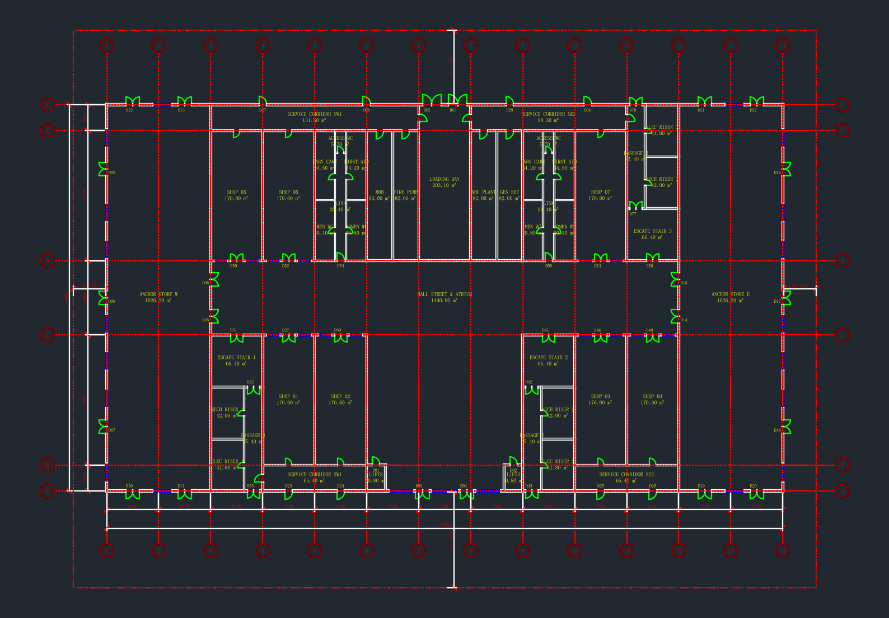 | 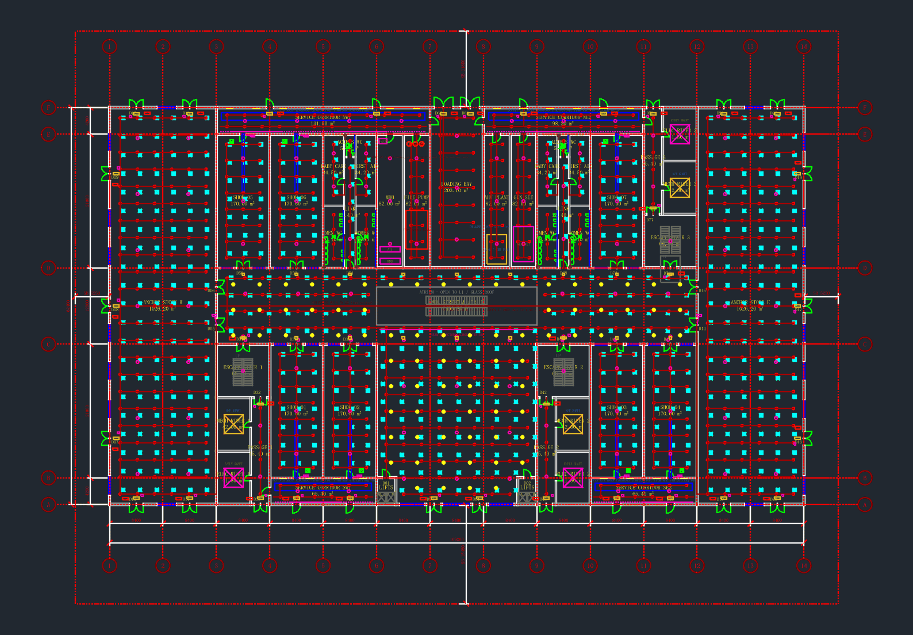 |

| Item | Value used | Source / status |
|---|---|---|
| Travel distance to exit (sprinklered) | <= 45 m; computed max GF 42.1 m, L1 42.1 m; stairs per level 3; exterior exit doors GF 29 | default 45 m sprinklered - number not in country file (verify with authority) ⚠ verify |
| Setbacks front / side / rear | 5 / 3 / 3 m (sheet code check: PASS) | ASSUMED 5/3/3 m - no commercial-zone setbacks in country file ⚠ verify |
| Escape stair / exit route clear width | >= 1200 mm (doors, passages, corridors) | rule of thumb 1200 mm clear ⚠ verify |
| Parking | required 264 bays (GLA 6593 m2 / 25 m2 per bay); 45 surface bays drawn as ground massing | rule of thumb 4 bays per 100 m2 GLA ⚠ verify; balance not modelled |
| GF height | 5000 mm | rule of thumb 4.5-5.5 m GF floor-to-floor ⚠ verify |
| Sprinklers | NFPA 13 OH2: <= 12.1 m2 and 4.6 m per head | references/disciplines/mep.md 4.1; grid 2.8 m is RoT |
| plan_audit | GF: 7 pass / 0 warn / 0 fail; L1: 7 pass / 0 warn / 0 fail | scripts/plan_audit.py |
| Files | GF-MEP.png, GF-audit.txt, GF-plan.png, GF.json, L1-audit.txt, L1.json, dxf-ifc.zip, ifc.txt, mall.json | |

### de

**Germany** - sheet M 1:250, floor-to-floor GF 5000 mm / upper 4500 mm, footprint 109.2 x 62.4 m on a 120 x 90 m plot (coverage 63.1 %).

| Plan GF | MEP GF | Render (3ds Max ART) |
|---|---|---|
| 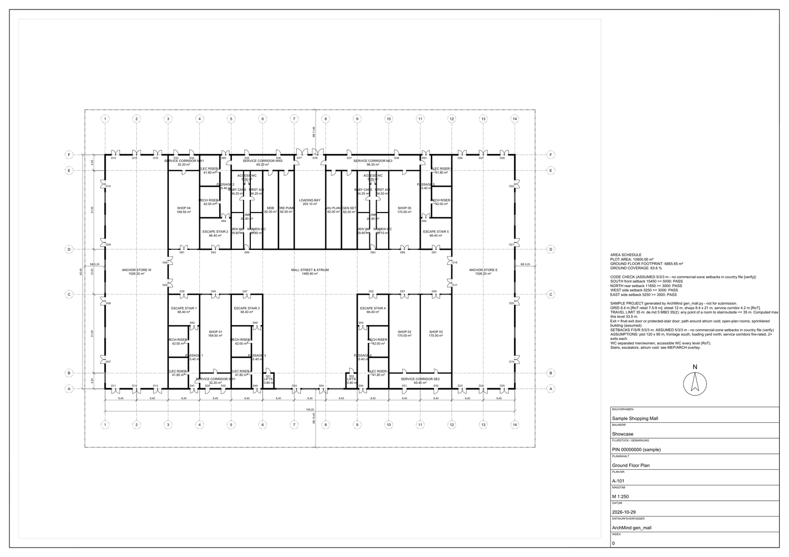 | 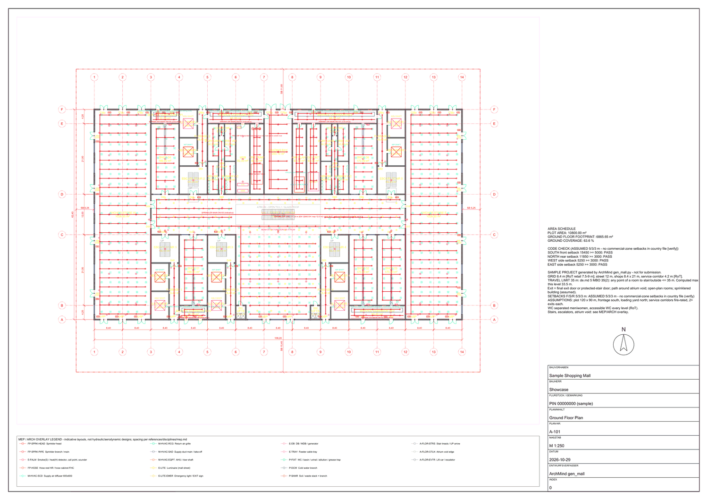 | 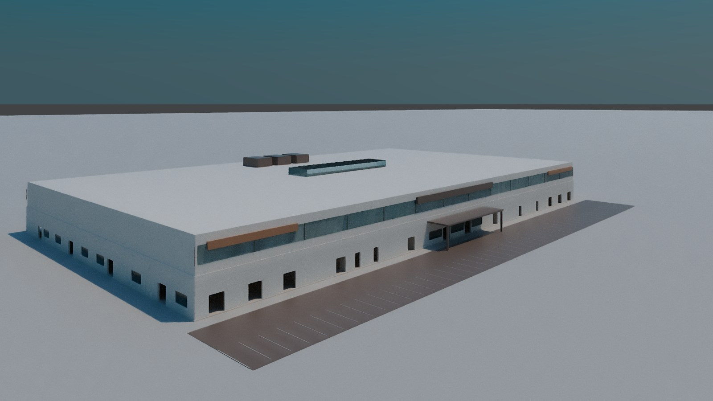 |

| Item | Value used | Source / status |
|---|---|---|
| Travel distance to exit (sprinklered) | <= 35 m; computed max GF 33.5 m, L1 33.5 m; stairs per level 5; exterior exit doors GF 39 | de.md 5 MBO 35(2): any point of a room to stair/outside <= 35 m ✓ |
| Setbacks front / side / rear | 5 / 3 / 3 m (sheet code check: PASS) | ASSUMED 5/3/3 m - no commercial-zone setbacks in country file ⚠ verify |
| Escape stair / exit route clear width | >= 1000 mm (doors, passages, corridors) | de.md 5 stair clear width >= 1.00 m ✓ |
| Parking | required 237 bays (GLA 5909 m2 / 25 m2 per bay); 45 surface bays drawn as ground massing | rule of thumb 4 bays per 100 m2 GLA ⚠ verify; balance not modelled |
| GF height | 5000 mm | rule of thumb 4.5-5.5 m GF floor-to-floor ⚠ verify |
| Sprinklers | EN 12845 OH: <= 12.0 m2 and 4 m per head | references/disciplines/mep.md 4.1; grid 2.8 m is RoT |
| plan_audit | GF: 7 pass / 0 warn / 0 fail; L1: 7 pass / 0 warn / 0 fail | scripts/plan_audit.py |
| AutoCAD 2026 (accoreconsole, `acad_verify.py`) | GF.dxf: AUDIT_ERRORS=0, ON_LAYER_0=0, layers 14, entities 1379; GF-MEP.dxf: AUDIT_ERRORS=0, ON_LAYER_0=0, layers 37, entities 6682; DWG + PDF written; PNG previews are made from the AutoCAD PDF | verified |
| Files | GF-MEP-report.txt, GF-MEP.dwg, GF-MEP.pdf, GF-MEP.png, GF-audit.txt, GF-plan.png, GF-report.txt, GF.dwg, GF.dxf, GF.ifc, GF.json, GF.pdf, L1-audit.txt, L1.json, extra-dxf.zip, ifc.txt, mall.json, render.jpg | |

### eg

**Egypt** - sheet 1:250, floor-to-floor GF 5000 mm / upper 4500 mm, footprint 109.2 x 62.4 m on a 120 x 90 m plot (coverage 63.1 %).

| Plan GF | MEP GF | Render (3ds Max ART) |
|---|---|---|
| 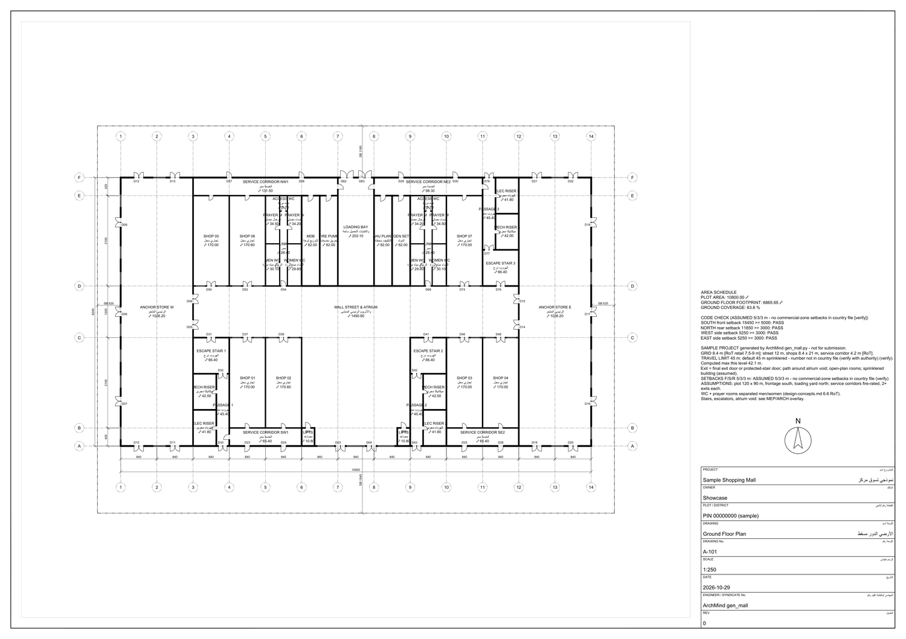 | 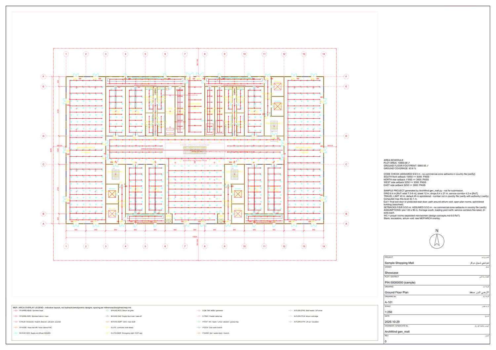 |  |

| Item | Value used | Source / status |
|---|---|---|
| Travel distance to exit (sprinklered) | <= 45 m; computed max GF 42.1 m, L1 42.1 m; stairs per level 3; exterior exit doors GF 29 | default 45 m sprinklered - number not in country file (verify with authority) ⚠ verify |
| Setbacks front / side / rear | 5 / 3 / 3 m (sheet code check: PASS) | ASSUMED 5/3/3 m - no commercial-zone setbacks in country file ⚠ verify |
| Escape stair / exit route clear width | >= 1200 mm (doors, passages, corridors) | rule of thumb 1200 mm clear ⚠ verify |
| Parking | required 264 bays (GLA 6593 m2 / 25 m2 per bay); 45 surface bays drawn as ground massing | rule of thumb 4 bays per 100 m2 GLA ⚠ verify; balance not modelled |
| GF height | 5000 mm | rule of thumb 4.5-5.5 m GF floor-to-floor ⚠ verify |
| Sprinklers | NFPA 13 OH2: <= 12.1 m2 and 4.6 m per head | references/disciplines/mep.md 4.1; grid 2.8 m is RoT |
| plan_audit | GF: 7 pass / 0 warn / 0 fail; L1: 7 pass / 0 warn / 0 fail | scripts/plan_audit.py |
| AutoCAD 2026 (accoreconsole, `acad_verify.py`) | GF.dxf: AUDIT_ERRORS=0, ON_LAYER_0=0, layers 14, entities 1303; GF-MEP.dxf: AUDIT_ERRORS=0, ON_LAYER_0=0, layers 37, entities 6749; DWG + PDF written; PNG previews are made from the AutoCAD PDF | verified |
| Files | GF-MEP-report.txt, GF-MEP.dwg, GF-MEP.pdf, GF-MEP.png, GF-audit.txt, GF-plan.png, GF-report.txt, GF.dwg, GF.dxf, GF.ifc, GF.json, GF.pdf, L1-audit.txt, L1.json, extra-dxf.zip, ifc.txt, mall.json, render.jpg | |

### es

**Spain** - sheet Esc. 1:250, floor-to-floor GF 5000 mm / upper 4500 mm, footprint 109.2 x 62.4 m on a 120 x 90 m plot (coverage 63.1 %).

| Plan GF | MEP GF |
|---|---|
|  |  |

| Item | Value used | Source / status |
|---|---|---|
| Travel distance to exit (sprinklered) | <= 50 m; computed max GF 42.1 m, L1 42.1 m; stairs per level 3; exterior exit doors GF 29 | es.md 5 DB-SI 3 Tabla 3.1: 50 m with more than one exit ⚠ verify |
| Setbacks front / side / rear | 5 / 3 / 3 m (sheet code check: PASS) | ASSUMED 5/3/3 m - no commercial-zone setbacks in country file ⚠ verify |
| Escape stair / exit route clear width | >= 1200 mm (doors, passages, corridors) | rule of thumb 1200 mm clear ⚠ verify |
| Parking | required 264 bays (GLA 6593 m2 / 25 m2 per bay); 45 surface bays drawn as ground massing | rule of thumb 4 bays per 100 m2 GLA ⚠ verify; balance not modelled |
| GF height | 5000 mm | rule of thumb 4.5-5.5 m GF floor-to-floor ⚠ verify |
| Sprinklers | EN 12845 OH: <= 12.0 m2 and 4 m per head | references/disciplines/mep.md 4.1; grid 2.8 m is RoT |
| plan_audit | GF: 7 pass / 0 warn / 0 fail; L1: 7 pass / 0 warn / 0 fail | scripts/plan_audit.py |
| Files | GF-MEP.png, GF-audit.txt, GF-plan.png, GF.json, L1-audit.txt, L1.json, dxf-ifc.zip, ifc.txt, mall.json | |

### fr

**France** - sheet Éch. 1/250, floor-to-floor GF 5000 mm / upper 4500 mm, footprint 109.2 x 62.4 m on a 120 x 90 m plot (coverage 63.1 %).

| Plan GF | MEP GF |
|---|---|
| 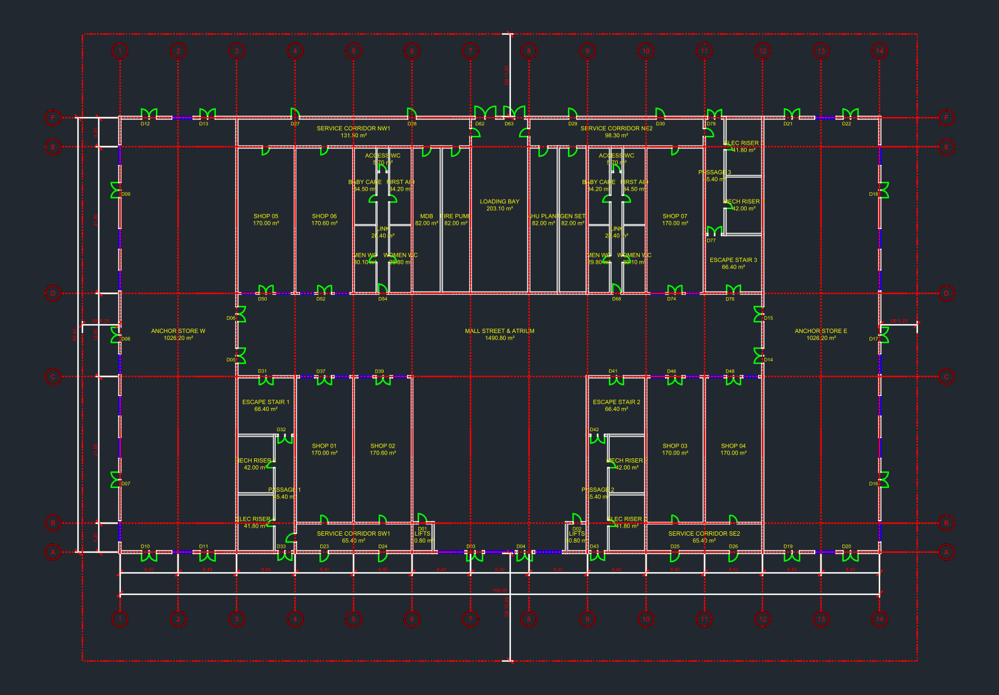 |  |

| Item | Value used | Source / status |
|---|---|---|
| Travel distance to exit (sprinklered) | <= 45 m; computed max GF 42.1 m, L1 42.1 m; stairs per level 3; exterior exit doors GF 29 | default 45 m sprinklered - number not in country file (verify with authority) ⚠ verify |
| Setbacks front / side / rear | 5 / 3 / 3 m (sheet code check: PASS) | ASSUMED 5/3/3 m - no commercial-zone setbacks in country file ⚠ verify |
| Escape stair / exit route clear width | >= 1200 mm (doors, passages, corridors) | fr.md 5 ERP art. 7-1 stairs >= 1.20 m between handrails ✓ |
| Parking | required 264 bays (GLA 6593 m2 / 25 m2 per bay); 45 surface bays drawn as ground massing | rule of thumb 4 bays per 100 m2 GLA ⚠ verify; balance not modelled |
| GF height | 5000 mm | rule of thumb 4.5-5.5 m GF floor-to-floor ⚠ verify |
| Sprinklers | EN 12845 OH: <= 12.0 m2 and 4 m per head | references/disciplines/mep.md 4.1; grid 2.8 m is RoT |
| plan_audit | GF: 7 pass / 0 warn / 0 fail; L1: 7 pass / 0 warn / 0 fail | scripts/plan_audit.py |
| Files | GF-MEP.png, GF-audit.txt, GF-plan.png, GF.json, L1-audit.txt, L1.json, dxf-ifc.zip, ifc.txt, mall.json | |

### in

**India** - sheet 1:250 @ A1, floor-to-floor GF 5000 mm / upper 4500 mm, footprint 109.2 x 62.4 m on a 120 x 90 m plot (coverage 63.1 %).

| Plan GF | MEP GF |
|---|---|
|  | 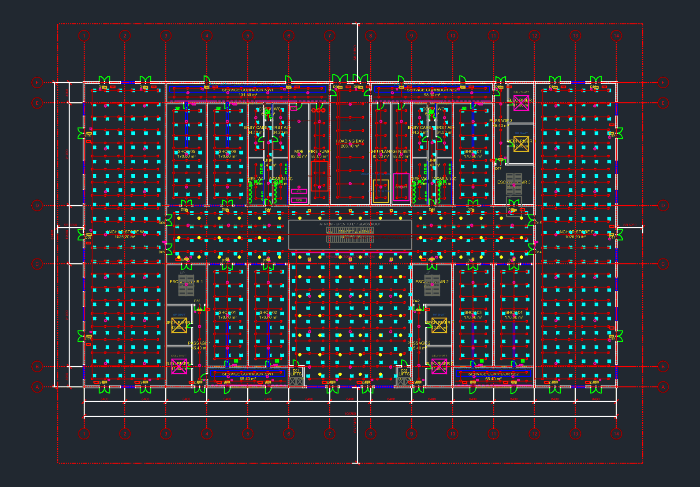 |

| Item | Value used | Source / status |
|---|---|---|
| Travel distance to exit (sprinklered) | <= 45 m; computed max GF 42.1 m, L1 42.1 m; stairs per level 3; exterior exit doors GF 29 | in.md 5 IS 16550 summary 45 m sprinklered (NBC Part 4 residential figure 30 m conflicts - verify) ⚠ verify |
| Setbacks front / side / rear | 5 / 3 / 3 m (sheet code check: PASS) | ASSUMED 5/3/3 m - no commercial-zone setbacks in country file ⚠ verify |
| Escape stair / exit route clear width | >= 1200 mm (doors, passages, corridors) | rule of thumb 1200 mm clear ⚠ verify |
| Parking | required 66 bays (GLA 6593 m2 / 100 m2 per bay); 45 surface bays drawn as ground massing | in.md 5 1 ECS per ~100 m2 built-up ⚠ verify; balance not modelled |
| GF height | 5000 mm | rule of thumb 4.5-5.5 m GF floor-to-floor ⚠ verify |
| Sprinklers | NFPA 13 OH2: <= 12.1 m2 and 4.6 m per head | references/disciplines/mep.md 4.1; grid 2.8 m is RoT |
| plan_audit | GF: 7 pass / 0 warn / 0 fail; L1: 7 pass / 0 warn / 0 fail | scripts/plan_audit.py |
| Files | GF-MEP.png, GF-audit.txt, GF-plan.png, GF.json, L1-audit.txt, L1.json, dxf-ifc.zip, ifc.txt, mall.json | |

### it

**Italy** - sheet Scala 1:250, floor-to-floor GF 5000 mm / upper 4500 mm, footprint 109.2 x 62.4 m on a 120 x 90 m plot (coverage 63.1 %).

| Plan GF | MEP GF |
|---|---|
|  |  |

| Item | Value used | Source / status |
|---|---|---|
| Travel distance to exit (sprinklered) | <= 45 m; computed max GF 42.1 m, L1 42.1 m; stairs per level 3; exterior exit doors GF 29 | default 45 m sprinklered - number not in country file (verify with authority) ⚠ verify |
| Setbacks front / side / rear | 5 / 3 / 3 m (sheet code check: PASS) | ASSUMED 5/3/3 m - no commercial-zone setbacks in country file ⚠ verify |
| Escape stair / exit route clear width | >= 1200 mm (doors, passages, corridors) | it.md 5 common stairs >= 1.20 m ✓ |
| Parking | required 264 bays (GLA 6593 m2 / 25 m2 per bay); 45 surface bays drawn as ground massing | rule of thumb 4 bays per 100 m2 GLA ⚠ verify; balance not modelled |
| GF height | 5000 mm | rule of thumb 4.5-5.5 m GF floor-to-floor ⚠ verify |
| Sprinklers | EN 12845 OH: <= 12.0 m2 and 4 m per head | references/disciplines/mep.md 4.1; grid 2.8 m is RoT |
| plan_audit | GF: 7 pass / 0 warn / 0 fail; L1: 7 pass / 0 warn / 0 fail | scripts/plan_audit.py |
| Files | GF-MEP.png, GF-audit.txt, GF-plan.png, GF.json, L1-audit.txt, L1.json, dxf-ifc.zip, ifc.txt, mall.json | |

### jo

**Jordan** - sheet 1:250 @ A1, floor-to-floor GF 5000 mm / upper 4500 mm, footprint 109.2 x 62.4 m on a 120 x 90 m plot (coverage 63.1 %).

| Plan GF | MEP GF |
|---|---|
| 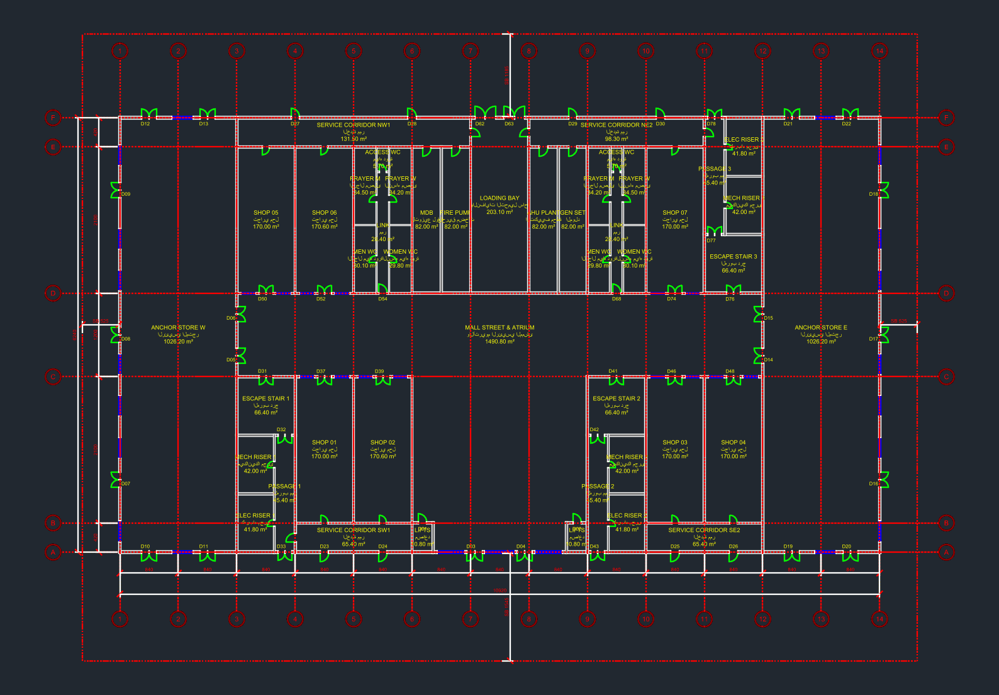 |  |

| Item | Value used | Source / status |
|---|---|---|
| Travel distance to exit (sprinklered) | <= 45 m; computed max GF 42.1 m, L1 42.1 m; stairs per level 3; exterior exit doors GF 29 | default 45 m sprinklered - number not in country file (verify with authority) ⚠ verify |
| Setbacks front / side / rear | 5 / 3 / 3 m (sheet code check: PASS) | ASSUMED 5/3/3 m - no commercial-zone setbacks in country file ⚠ verify |
| Escape stair / exit route clear width | >= 1200 mm (doors, passages, corridors) | rule of thumb 1200 mm clear ⚠ verify |
| Parking | required 264 bays (GLA 6593 m2 / 25 m2 per bay); 45 surface bays drawn as ground massing | rule of thumb 4 bays per 100 m2 GLA ⚠ verify; balance not modelled |
| GF height | 5000 mm | rule of thumb 4.5-5.5 m GF floor-to-floor ⚠ verify |
| Sprinklers | NFPA 13 OH2: <= 12.1 m2 and 4.6 m per head | references/disciplines/mep.md 4.1; grid 2.8 m is RoT |
| plan_audit | GF: 7 pass / 0 warn / 0 fail; L1: 7 pass / 0 warn / 0 fail | scripts/plan_audit.py |
| Files | GF-MEP.png, GF-audit.txt, GF-plan.png, GF.json, L1-audit.txt, L1.json, dxf-ifc.zip, ifc.txt, mall.json | |

### jp

**Japan** - sheet S=1/250, floor-to-floor GF 5000 mm / upper 4500 mm, footprint 109.2 x 62.4 m on a 120 x 90 m plot (coverage 63.1 %).

| Plan GF | MEP GF |
|---|---|
| 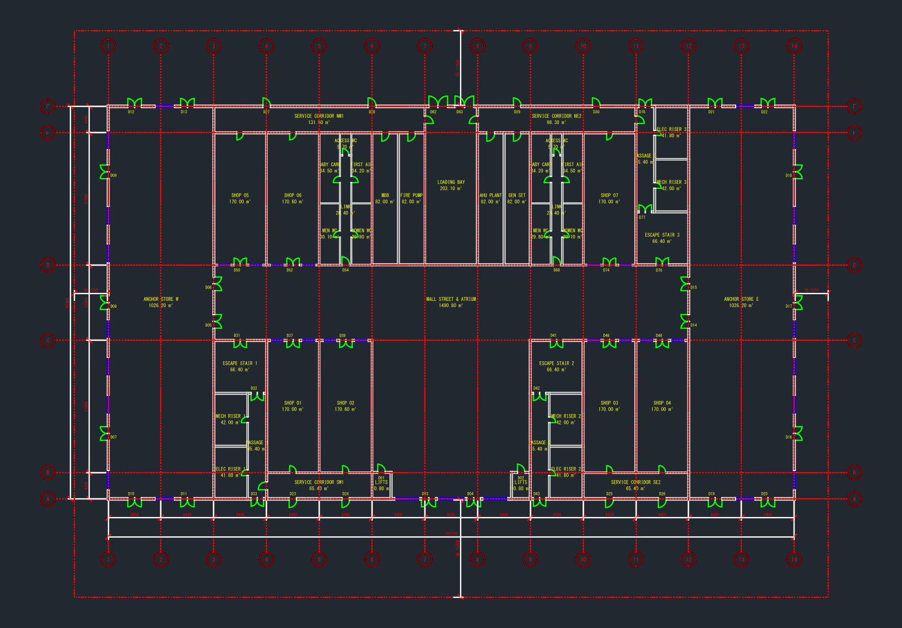 |  |

| Item | Value used | Source / status |
|---|---|---|
| Travel distance to exit (sprinklered) | <= 50 m; computed max GF 42.1 m, L1 42.1 m; stairs per level 3; exterior exit doors GF 29 | jp.md 5 Ord. 120: 50 m (fire-resistive main structure) ✓ |
| Setbacks front / side / rear | 5 / 3 / 3 m (sheet code check: PASS) | ASSUMED 5/3/3 m - no commercial-zone setbacks in country file ⚠ verify |
| Max coverage | 80 % (this mall 63.1 %) | jp.md 5 coverage ratio commercial 8/10 (Law 53(1)) ✓ |
| Escape stair / exit route clear width | >= 1400 mm (doors, passages, corridors) | jp.md 5 Ord. 23(1): shops > 1500 m2 stair width 140 cm ✓ |
| Parking | required 264 bays (GLA 6593 m2 / 25 m2 per bay); 45 surface bays drawn as ground massing | rule of thumb 4 bays per 100 m2 GLA ⚠ verify; balance not modelled |
| GF height | 5000 mm | rule of thumb 4.5-5.5 m GF floor-to-floor ⚠ verify |
| Sprinklers | NFPA 13 OH2: <= 12.1 m2 and 4.6 m per head | references/disciplines/mep.md 4.1; grid 2.8 m is RoT |
| plan_audit | GF: 7 pass / 0 warn / 0 fail; L1: 7 pass / 0 warn / 0 fail | scripts/plan_audit.py |
| Files | GF-MEP.png, GF-audit.txt, GF-plan.png, GF.json, L1-audit.txt, L1.json, dxf-ifc.zip, ifc.txt, mall.json | |

### kw

**Kuwait** - sheet 1:250 @ A1, floor-to-floor GF 5000 mm / upper 4500 mm, footprint 109.2 x 62.4 m on a 120 x 90 m plot (coverage 63.1 %).

| Plan GF | MEP GF |
|---|---|
| 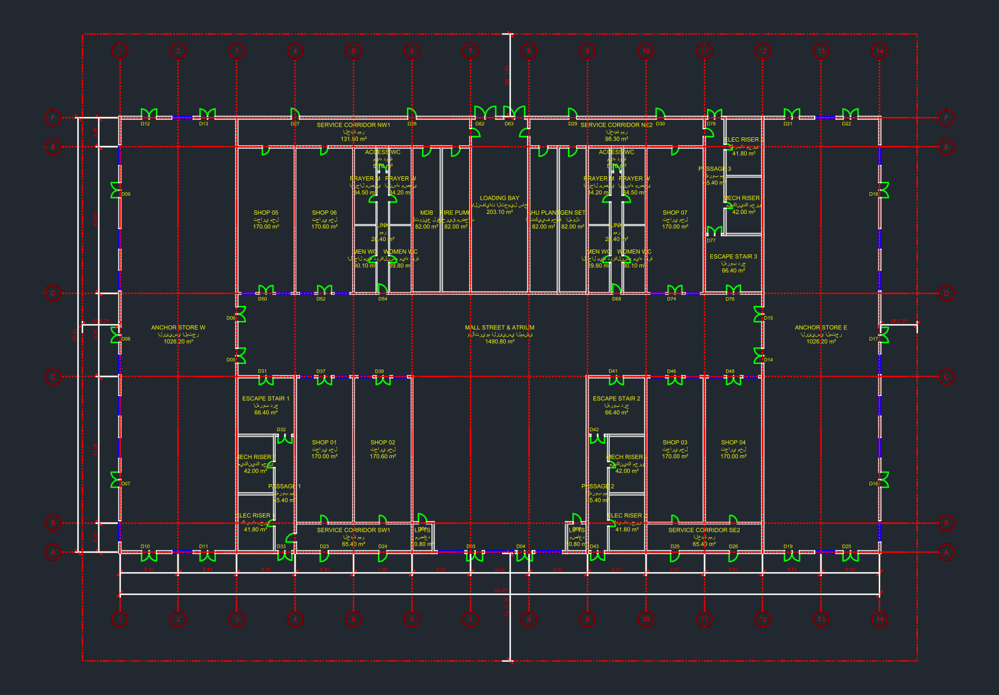 | 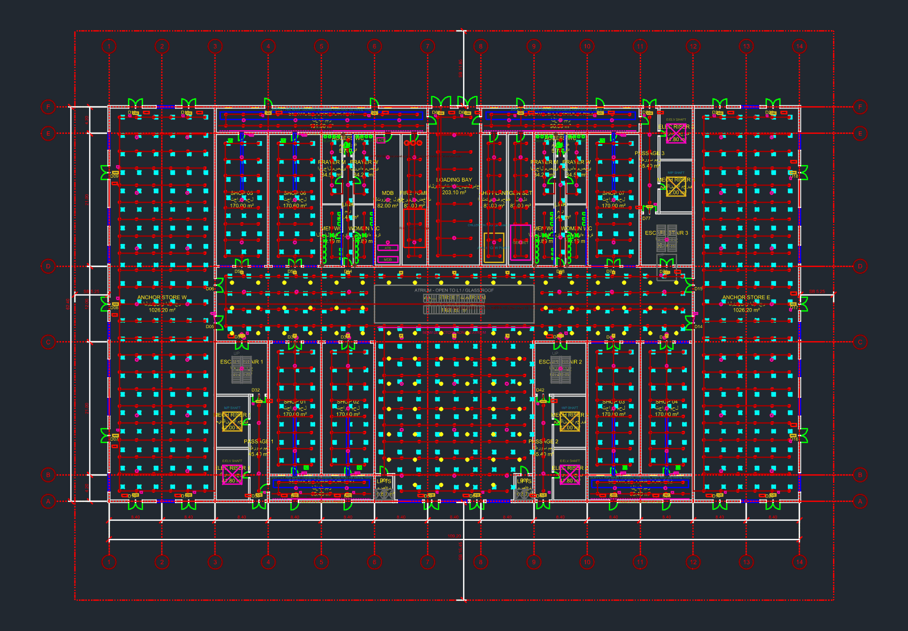 |

| Item | Value used | Source / status |
|---|---|---|
| Travel distance to exit (sprinklered) | <= 45 m; computed max GF 42.1 m, L1 42.1 m; stairs per level 3; exterior exit doors GF 29 | default 45 m sprinklered - number not in country file (verify with authority) ⚠ verify |
| Setbacks front / side / rear | 5 / 3 / 3 m (sheet code check: PASS) | ASSUMED 5/3/3 m - no commercial-zone setbacks in country file ⚠ verify |
| Escape stair / exit route clear width | >= 1200 mm (doors, passages, corridors) | rule of thumb 1200 mm clear ⚠ verify |
| Parking | required 264 bays (GLA 6593 m2 / 25 m2 per bay); 45 surface bays drawn as ground massing | rule of thumb 4 bays per 100 m2 GLA ⚠ verify; balance not modelled |
| GF height | 5000 mm | rule of thumb 4.5-5.5 m GF floor-to-floor ⚠ verify |
| Sprinklers | NFPA 13 OH2: <= 12.1 m2 and 4.6 m per head | references/disciplines/mep.md 4.1; grid 2.8 m is RoT |
| plan_audit | GF: 7 pass / 0 warn / 0 fail; L1: 7 pass / 0 warn / 0 fail | scripts/plan_audit.py |
| Files | GF-MEP.png, GF-audit.txt, GF-plan.png, GF.json, L1-audit.txt, L1.json, dxf-ifc.zip, ifc.txt, mall.json | |

### ma

**Morocco** - sheet Éch. 1/250, floor-to-floor GF 5000 mm / upper 4500 mm, footprint 109.2 x 62.4 m on a 120 x 90 m plot (coverage 63.1 %).

| Plan GF | MEP GF |
|---|---|
|  | 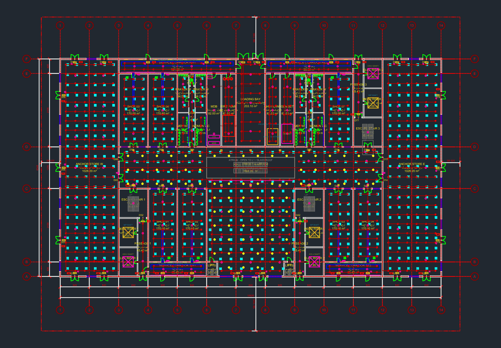 |

| Item | Value used | Source / status |
|---|---|---|
| Travel distance to exit (sprinklered) | <= 45 m; computed max GF 42.1 m, L1 42.1 m; stairs per level 3; exterior exit doors GF 29 | default 45 m sprinklered - number not in country file (verify with authority) ⚠ verify |
| Setbacks front / side / rear | 5 / 3 / 3 m (sheet code check: PASS) | ASSUMED 5/3/3 m - no commercial-zone setbacks in country file ⚠ verify |
| Escape stair / exit route clear width | >= 1200 mm (doors, passages, corridors) | rule of thumb 1200 mm clear ⚠ verify |
| Parking | required 264 bays (GLA 6593 m2 / 25 m2 per bay); 45 surface bays drawn as ground massing | rule of thumb 4 bays per 100 m2 GLA ⚠ verify; balance not modelled |
| GF height | 5000 mm | rule of thumb 4.5-5.5 m GF floor-to-floor ⚠ verify |
| Sprinklers | NFPA 13 OH2: <= 12.1 m2 and 4.6 m per head | references/disciplines/mep.md 4.1; grid 2.8 m is RoT |
| plan_audit | GF: 7 pass / 0 warn / 0 fail; L1: 7 pass / 0 warn / 0 fail | scripts/plan_audit.py |
| Files | GF-MEP.png, GF-audit.txt, GF-plan.png, GF.json, L1-audit.txt, L1.json, dxf-ifc.zip, ifc.txt, mall.json | |

### mx

**Mexico** - sheet Esc. 1:250, floor-to-floor GF 5000 mm / upper 4500 mm, footprint 109.2 x 62.4 m on a 120 x 90 m plot (coverage 63.1 %).

| Plan GF | MEP GF |
|---|---|
| 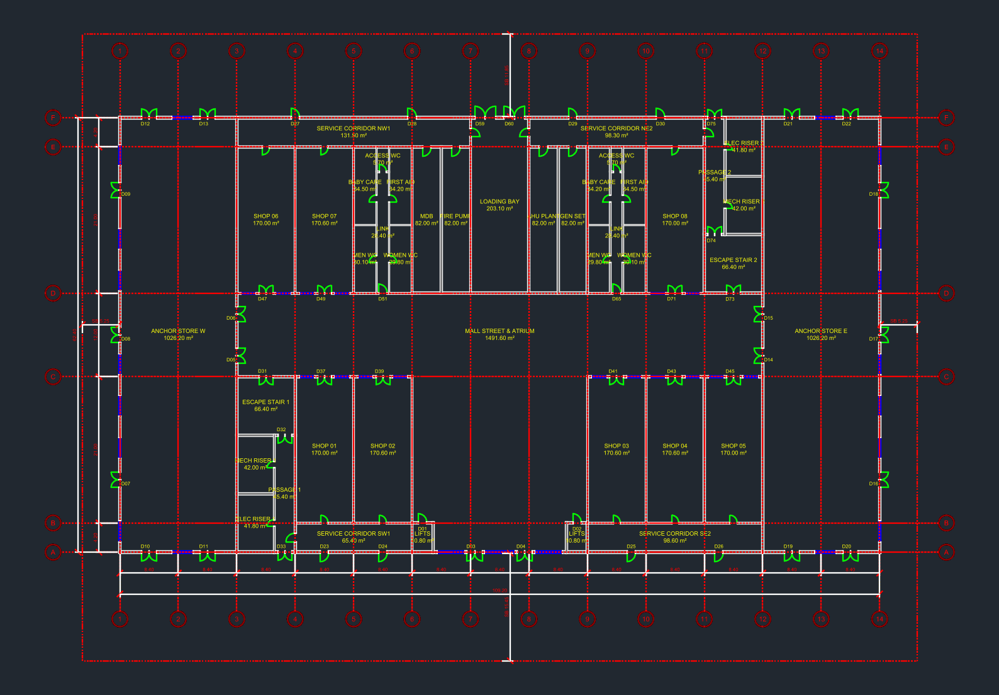 | 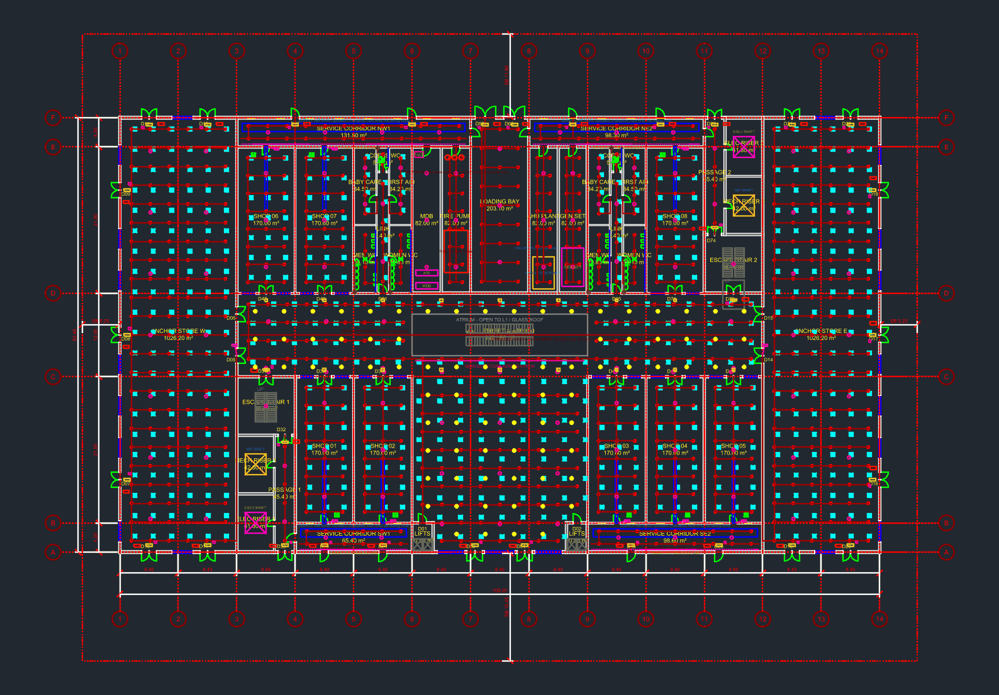 |

| Item | Value used | Source / status |
|---|---|---|
| Travel distance to exit (sprinklered) | <= 60 m; computed max GF 42.1 m, L1 51.6 m; stairs per level 2; exterior exit doors GF 28 | mx.md 5 Art. 92: 40 m medium risk +50 % with sprinklers (risk class assumed medium) ⚠ verify |
| Setbacks front / side / rear | 5 / 3 / 3 m (sheet code check: PASS) | ASSUMED 5/3/3 m - no commercial-zone setbacks in country file ⚠ verify |
| Escape stair / exit route clear width | >= 1200 mm (doors, passages, corridors) | rule of thumb 1200 mm clear ⚠ verify |
| Parking | required 278 bays (GLA 6935 m2 / 25 m2 per bay); 45 surface bays drawn as ground massing | rule of thumb 4 bays per 100 m2 GLA ⚠ verify; balance not modelled |
| GF height | 5000 mm | rule of thumb 4.5-5.5 m GF floor-to-floor ⚠ verify |
| Sprinklers | NFPA 13 OH2: <= 12.1 m2 and 4.6 m per head | references/disciplines/mep.md 4.1; grid 2.8 m is RoT |
| plan_audit | GF: 7 pass / 0 warn / 0 fail; L1: 7 pass / 0 warn / 0 fail | scripts/plan_audit.py |
| Files | GF-MEP.png, GF-audit.txt, GF-plan.png, GF.json, L1-audit.txt, L1.json, dxf-ifc.zip, ifc.txt, mall.json | |

### my

**Malaysia** - sheet 1:250 @ A1, floor-to-floor GF 5000 mm / upper 4500 mm, footprint 109.2 x 62.4 m on a 120 x 90 m plot (coverage 63.1 %).

| Plan GF | MEP GF |
|---|---|
|  |  |

| Item | Value used | Source / status |
|---|---|---|
| Travel distance to exit (sprinklered) | <= 60 m; computed max GF 42.1 m, L1 51.6 m; stairs per level 2; exterior exit doors GF 28 | my.md 5 UBBL 188 assembly 60 m sprinklered; Seventh Schedule (shops) not read ⚠ verify |
| Setbacks front / side / rear | 5 / 3 / 3 m (sheet code check: PASS) | ASSUMED 5/3/3 m - no commercial-zone setbacks in country file ⚠ verify |
| Escape stair / exit route clear width | >= 1200 mm (doors, passages, corridors) | rule of thumb 1200 mm clear ⚠ verify |
| Parking | required 278 bays (GLA 6935 m2 / 25 m2 per bay); 45 surface bays drawn as ground massing | rule of thumb 4 bays per 100 m2 GLA ⚠ verify; balance not modelled |
| GF height | 5000 mm | rule of thumb 4.5-5.5 m GF floor-to-floor ⚠ verify |
| Sprinklers | NFPA 13 OH2: <= 12.1 m2 and 4.6 m per head | references/disciplines/mep.md 4.1; grid 2.8 m is RoT |
| plan_audit | GF: 7 pass / 0 warn / 0 fail; L1: 7 pass / 0 warn / 0 fail | scripts/plan_audit.py |
| Files | GF-MEP.png, GF-audit.txt, GF-plan.png, GF.json, L1-audit.txt, L1.json, dxf-ifc.zip, ifc.txt, mall.json | |

### ng

**Nigeria** - sheet 1:250 @ A1, floor-to-floor GF 5000 mm / upper 4500 mm, footprint 109.2 x 62.4 m on a 120 x 90 m plot (coverage 63.1 %).

| Plan GF | MEP GF |
|---|---|
| 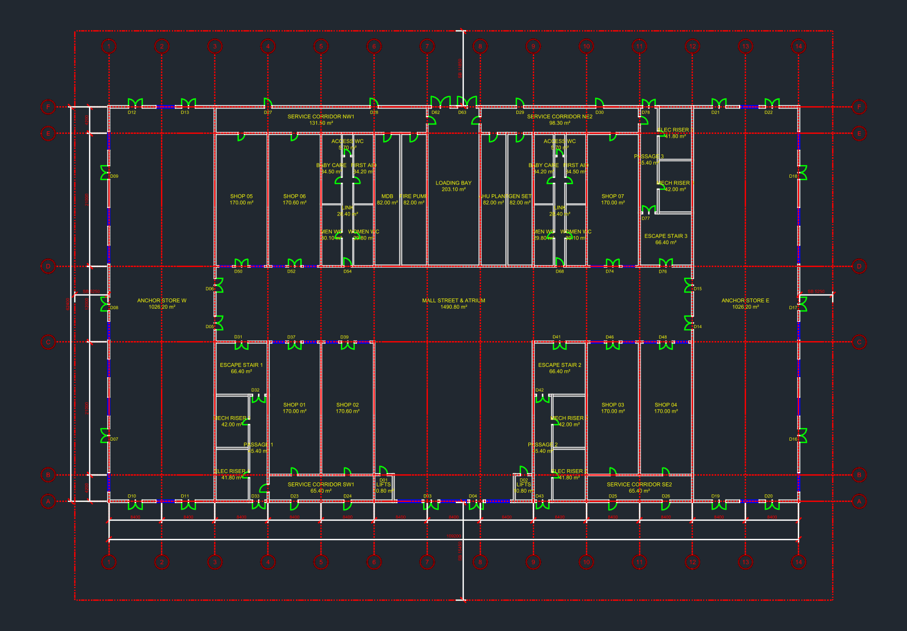 |  |

| Item | Value used | Source / status |
|---|---|---|
| Travel distance to exit (sprinklered) | <= 45 m; computed max GF 42.1 m, L1 42.1 m; stairs per level 3; exterior exit doors GF 29 | default 45 m sprinklered - number not in country file (verify with authority) ⚠ verify |
| Setbacks front / side / rear | 5 / 3 / 3 m (sheet code check: PASS) | ASSUMED 5/3/3 m - no commercial-zone setbacks in country file ⚠ verify |
| Escape stair / exit route clear width | >= 1200 mm (doors, passages, corridors) | rule of thumb 1200 mm clear ⚠ verify |
| Parking | required 264 bays (GLA 6593 m2 / 25 m2 per bay); 45 surface bays drawn as ground massing | rule of thumb 4 bays per 100 m2 GLA ⚠ verify; balance not modelled |
| GF height | 5000 mm | rule of thumb 4.5-5.5 m GF floor-to-floor ⚠ verify |
| Sprinklers | NFPA 13 OH2: <= 12.1 m2 and 4.6 m per head | references/disciplines/mep.md 4.1; grid 2.8 m is RoT |
| plan_audit | GF: 7 pass / 0 warn / 0 fail; L1: 7 pass / 0 warn / 0 fail | scripts/plan_audit.py |
| Files | GF-MEP.png, GF-audit.txt, GF-plan.png, GF.json, L1-audit.txt, L1.json, dxf-ifc.zip, ifc.txt, mall.json | |

### om

**Oman** - sheet 1:250 @ A1, floor-to-floor GF 4800 mm / upper 4500 mm, footprint 109.2 x 62.4 m on a 120 x 90 m plot (coverage 63.1 %).

| Plan GF | MEP GF |
|---|---|
| 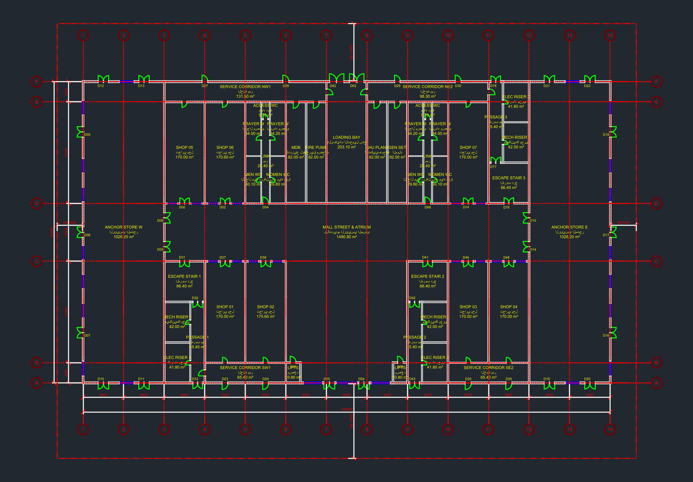 |  |

| Item | Value used | Source / status |
|---|---|---|
| Travel distance to exit (sprinklered) | <= 45 m; computed max GF 42.1 m, L1 42.1 m; stairs per level 3; exterior exit doors GF 29 | default 45 m sprinklered - number not in country file (verify with authority) ⚠ verify |
| Setbacks front / side / rear | 5 / 3 / 3 m (sheet code check: PASS) | ASSUMED 5/3/3 m - no commercial-zone setbacks in country file ⚠ verify |
| Escape stair / exit route clear width | >= 1200 mm (doors, passages, corridors) | rule of thumb 1200 mm clear ⚠ verify |
| Parking | required 264 bays (GLA 6593 m2 / 25 m2 per bay); 45 surface bays drawn as ground massing | rule of thumb 4 bays per 100 m2 GLA ⚠ verify; balance not modelled |
| GF height | 4800 mm | om.md 5 residential-commercial ground floor internal height 4.0-4.8 m (max used) ✓ |
| Sprinklers | NFPA 13 OH2: <= 12.1 m2 and 4.6 m per head | references/disciplines/mep.md 4.1; grid 2.8 m is RoT |
| plan_audit | GF: 7 pass / 0 warn / 0 fail; L1: 7 pass / 0 warn / 0 fail | scripts/plan_audit.py |
| Files | GF-MEP.png, GF-audit.txt, GF-plan.png, GF.json, L1-audit.txt, L1.json, dxf-ifc.zip, ifc.txt, mall.json | |

### pk

**Pakistan** - sheet 1/16" = 1'-0", floor-to-floor GF 5000 mm / upper 4500 mm, footprint 109.2 x 62.4 m on a 120 x 90 m plot (coverage 63.1 %).

| Plan GF | MEP GF |
|---|---|
| 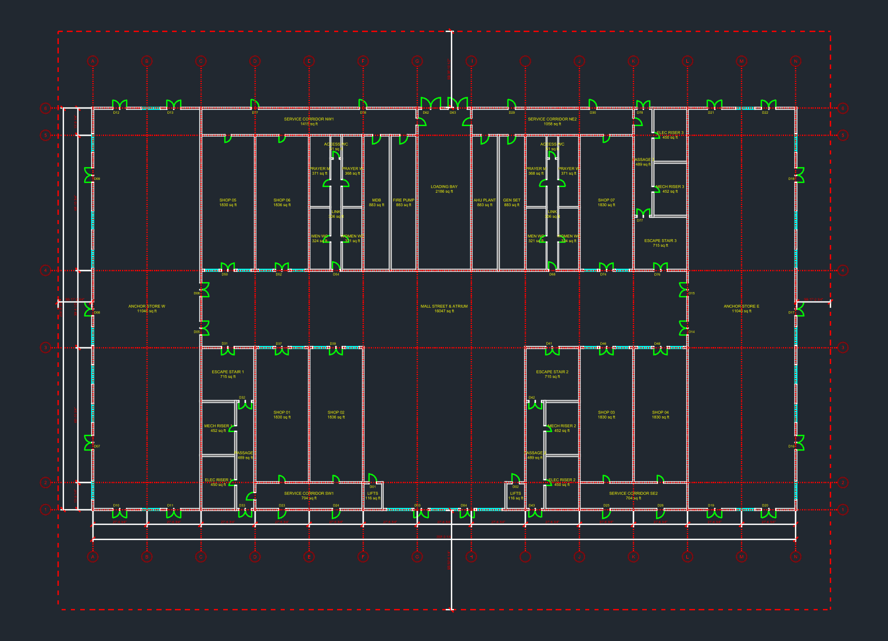 | 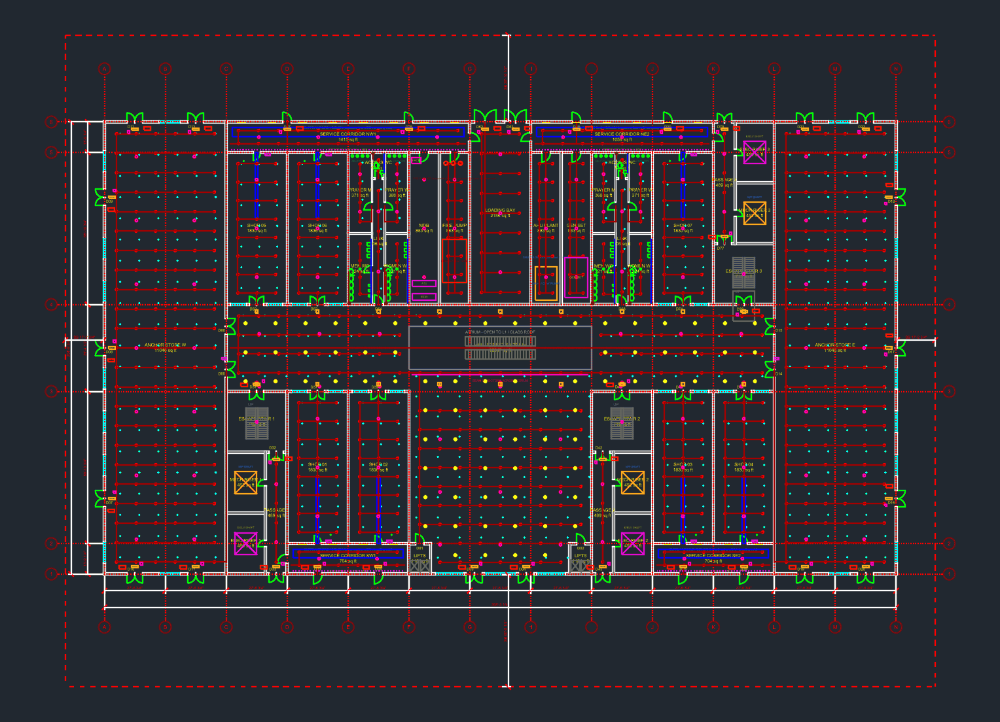 |

| Item | Value used | Source / status |
|---|---|---|
| Travel distance to exit (sprinklered) | <= 45 m; computed max GF 42.1 m, L1 42.1 m; stairs per level 3; exterior exit doors GF 29 | default 45 m sprinklered - number not in country file (verify with authority) ⚠ verify |
| Setbacks front / side / rear | 5 / 3 / 3 m (sheet code check: PASS) | ASSUMED 5/3/3 m - no commercial-zone setbacks in country file ⚠ verify |
| Escape stair / exit route clear width | >= 1200 mm (doors, passages, corridors) | rule of thumb 1200 mm clear ⚠ verify |
| Parking | required 264 bays (GLA 6593 m2 / 25 m2 per bay); 45 surface bays drawn as ground massing | rule of thumb 4 bays per 100 m2 GLA ⚠ verify; balance not modelled |
| GF height | 5000 mm | rule of thumb 4.5-5.5 m GF floor-to-floor ⚠ verify |
| Sprinklers | NFPA 13 OH2: <= 12.1 m2 and 4.6 m per head | references/disciplines/mep.md 4.1; grid 2.8 m is RoT |
| plan_audit | GF: 7 pass / 0 warn / 0 fail; L1: 7 pass / 0 warn / 0 fail | scripts/plan_audit.py |
| Files | GF-MEP.png, GF-audit.txt, GF-plan.png, GF.json, L1-audit.txt, L1.json, dxf-ifc.zip, ifc.txt, mall.json | |

### qa

**Qatar** - sheet 1:250 @ A1, floor-to-floor GF 5000 mm / upper 4500 mm, footprint 109.2 x 62.4 m on a 120 x 90 m plot (coverage 63.1 %).

| Plan GF | MEP GF | Render (3ds Max ART) |
|---|---|---|
| 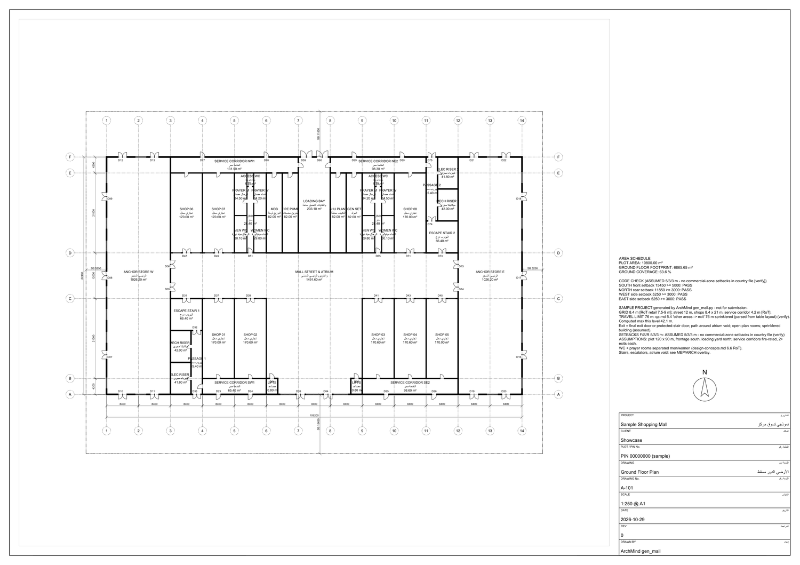 | 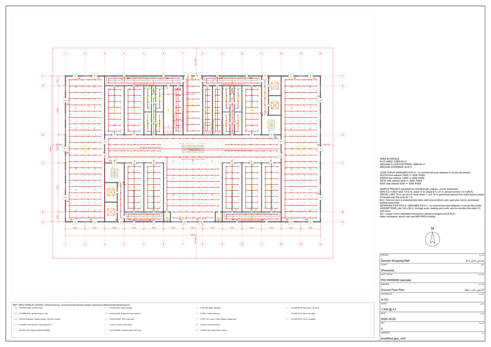 | 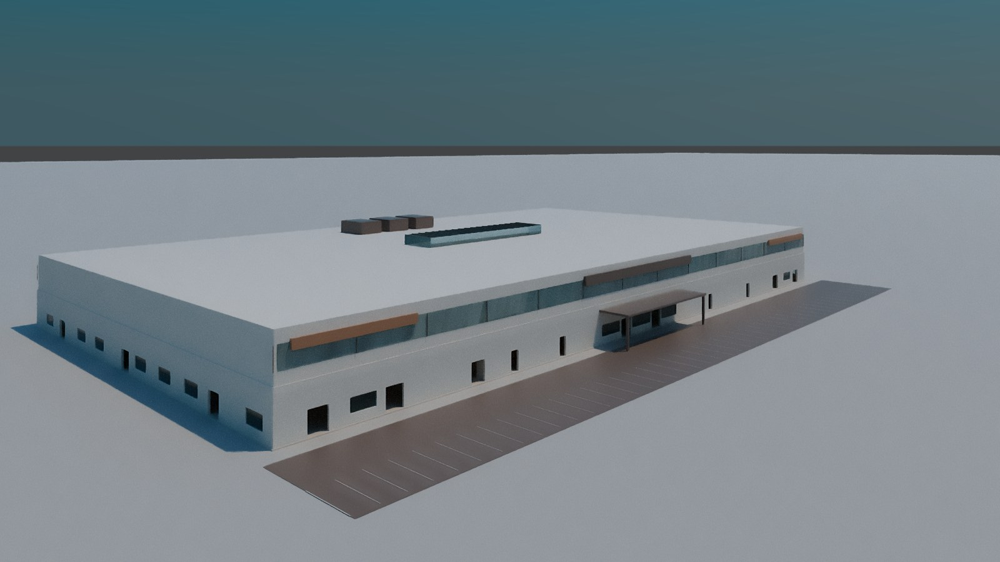 |

| Item | Value used | Source / status |
|---|---|---|
| Travel distance to exit (sprinklered) | <= 76 m; computed max GF 42.1 m, L1 51.6 m; stairs per level 2; exterior exit doors GF 28 | qa.md 5.4 'other areas -> exit' 76 m sprinklered (parsed from table layout) ⚠ verify |
| Setbacks front / side / rear | 5 / 3 / 3 m (sheet code check: PASS) | ASSUMED 5/3/3 m - no commercial-zone setbacks in country file ⚠ verify |
| Escape stair / exit route clear width | >= 1200 mm (doors, passages, corridors) | qa.md 5.4 corridor serving >50 persons >= 1200 mm ✓ |
| Parking | required 278 bays (GLA 6935 m2 / 25 m2 per bay); 45 surface bays drawn as ground massing | rule of thumb 4 bays per 100 m2 GLA ⚠ verify; balance not modelled |
| GF height | 5000 mm | rule of thumb 4.5-5.5 m GF floor-to-floor ⚠ verify |
| Sprinklers | NFPA 13 OH2: <= 12.1 m2 and 4.6 m per head | references/disciplines/mep.md 4.1; grid 2.8 m is RoT |
| plan_audit | GF: 7 pass / 0 warn / 0 fail; L1: 7 pass / 0 warn / 0 fail | scripts/plan_audit.py |
| AutoCAD 2026 (accoreconsole, `acad_verify.py`) | GF.dxf: AUDIT_ERRORS=0, ON_LAYER_0=0, layers 14, entities 1282; GF-MEP.dxf: AUDIT_ERRORS=0, ON_LAYER_0=0, layers 37, entities 6813; DWG + PDF written; PNG previews are made from the AutoCAD PDF | verified |
| Files | GF-MEP-report.txt, GF-MEP.dwg, GF-MEP.dxf, GF-MEP.pdf, GF-MEP.png, GF-audit.txt, GF-plan.png, GF-report.txt, GF.dwg, GF.dxf, GF.ifc, GF.json, GF.pdf, L1-audit.txt, L1.json, extra-dxf.zip, ifc.txt, mall.json, render.jpg | |

### sa

**Saudi Arabia** - sheet 1:250 @ A1, floor-to-floor GF 5000 mm / upper 4500 mm, footprint 109.2 x 62.4 m on a 120 x 90 m plot (coverage 63.1 %).

| Plan GF | MEP GF |
|---|---|
| 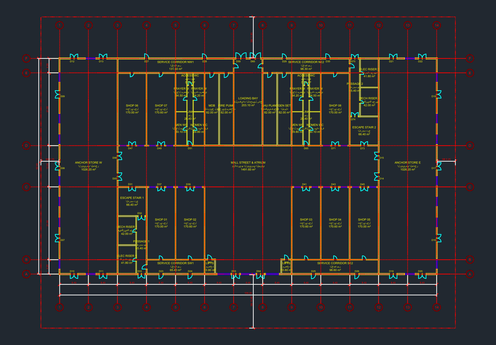 | 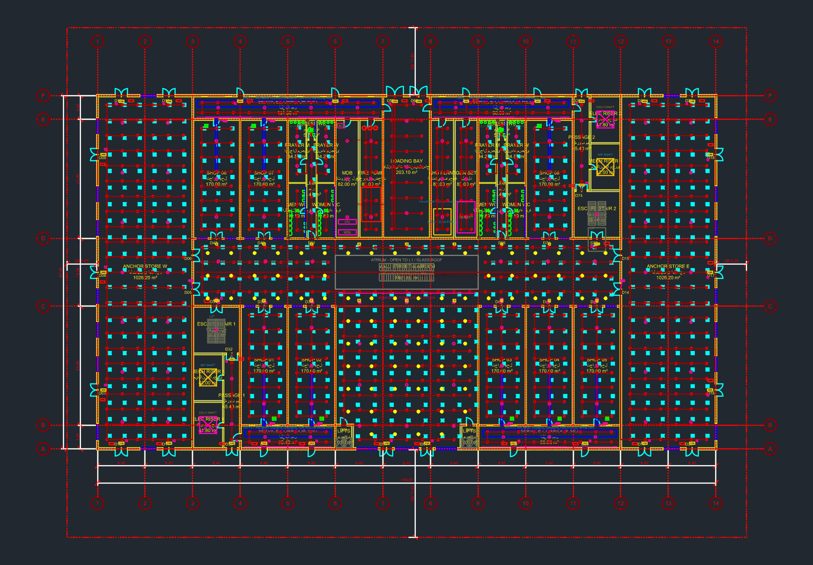 |

| Item | Value used | Source / status |
|---|---|---|
| Travel distance to exit (sprinklered) | <= 76 m; computed max GF 42.1 m, L1 51.6 m; stairs per level 2; exterior exit doors GF 28 | sa.md 5.5 SBC 201 R-2 sprinklered 76 m (B 91 m); mercantile not listed, IBC M 250 ft per us.md 5.3 ⚠ verify |
| Setbacks front / side / rear | 5 / 3 / 3 m (sheet code check: PASS) | ASSUMED 5/3/3 m - no commercial-zone setbacks in country file ⚠ verify |
| Escape stair / exit route clear width | >= 1118 mm (doors, passages, corridors) | sa.md 5.5 stairs 1118 mm (>=50 occupants) ⚠ verify |
| Parking | required 155 bays (GLA 6935 m2 / 45 m2 per bay); 45 surface bays drawn as ground massing | sa.md 5.6 shops 1 bay per 45 m2, min 1 per shop ✓; balance not modelled |
| GF height | 5000 mm | rule of thumb 4.5-5.5 m GF floor-to-floor ⚠ verify |
| Sprinklers | NFPA 13 OH2: <= 12.1 m2 and 4.6 m per head | references/disciplines/mep.md 4.1; grid 2.8 m is RoT |
| plan_audit | GF: 7 pass / 0 warn / 0 fail; L1: 7 pass / 0 warn / 0 fail | scripts/plan_audit.py |
| Files | GF-MEP.png, GF-audit.txt, GF-plan.png, GF.json, L1-audit.txt, L1.json, dxf-ifc.zip, ifc.txt, mall.json | |

### sg

**Singapore** - sheet 1:250 @ A1, floor-to-floor GF 5000 mm / upper 4500 mm, footprint 109.2 x 62.4 m on a 120 x 90 m plot (coverage 63.1 %).

| Plan GF | MEP GF |
|---|---|
|  |  |

| Item | Value used | Source / status |
|---|---|---|
| Travel distance to exit (sprinklered) | <= 45 m; computed max GF 42.1 m, L1 42.1 m; stairs per level 3; exterior exit doors GF 29 | default 45 m sprinklered - number not in country file (verify with authority) ⚠ verify |
| Setbacks front / side / rear | 5 / 3 / 3 m (sheet code check: PASS) | ASSUMED 5/3/3 m - no commercial-zone setbacks in country file ⚠ verify |
| Escape stair / exit route clear width | >= 1200 mm (doors, passages, corridors) | rule of thumb 1200 mm clear ⚠ verify |
| Parking | required 264 bays (GLA 6593 m2 / 25 m2 per bay); 45 surface bays drawn as ground massing | rule of thumb 4 bays per 100 m2 GLA ⚠ verify; balance not modelled |
| GF height | 5000 mm | rule of thumb 4.5-5.5 m GF floor-to-floor ⚠ verify |
| Sprinklers | NFPA 13 OH2: <= 12.1 m2 and 4.6 m per head | references/disciplines/mep.md 4.1; grid 2.8 m is RoT |
| plan_audit | GF: 7 pass / 0 warn / 0 fail; L1: 7 pass / 0 warn / 0 fail | scripts/plan_audit.py |
| Files | GF-MEP.png, GF-audit.txt, GF-plan.png, GF.json, L1-audit.txt, L1.json, dxf-ifc.zip, ifc.txt, mall.json | |

### tr

**Turkey** - sheet 1/250, floor-to-floor GF 4500 mm / upper 4500 mm, footprint 109.2 x 62.4 m on a 120 x 90 m plot (coverage 63.1 %).

| Plan GF | MEP GF |
|---|---|
| 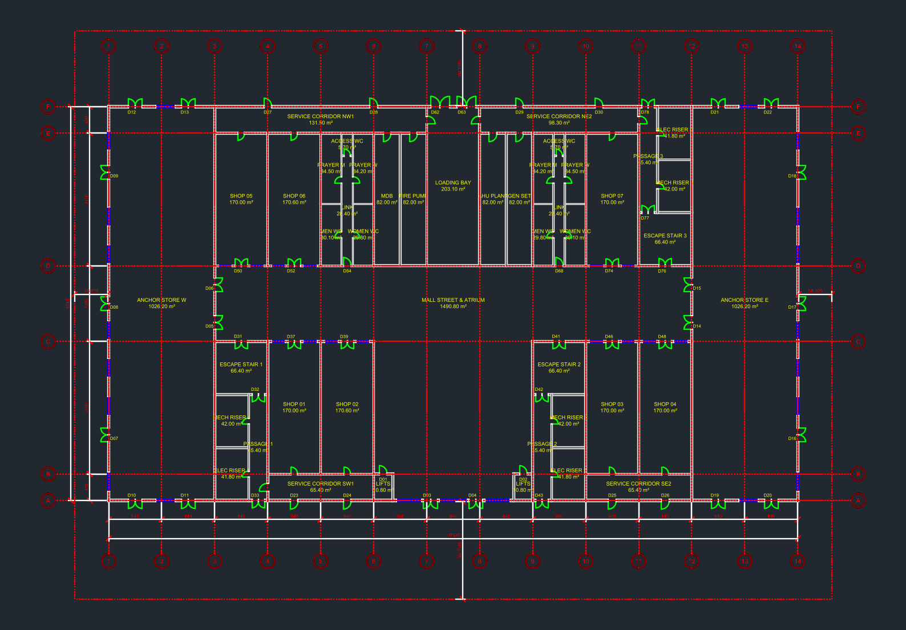 | 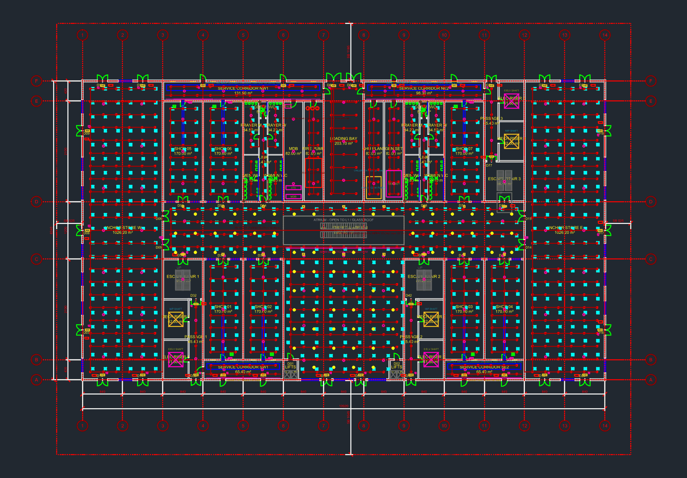 |

| Item | Value used | Source / status |
|---|---|---|
| Travel distance to exit (sprinklered) | <= 45 m; computed max GF 42.1 m, L1 42.1 m; stairs per level 3; exterior exit doors GF 29 | default 45 m sprinklered - number not in country file (verify with authority) ⚠ verify |
| Setbacks front / side / rear | 5 / 3 / 3 m (sheet code check: PASS) | tr.md 5.1 Imar Yonetmeligi Art. 23 defaults 5/3/3 m ✓ |
| Escape stair / exit route clear width | >= 1200 mm (doors, passages, corridors) | rule of thumb 1200 mm clear ⚠ verify |
| Parking | required 264 bays (GLA 6593 m2 / 25 m2 per bay); 45 surface bays drawn as ground massing | rule of thumb 4 bays per 100 m2 GLA ⚠ verify; balance not modelled |
| GF height | 4500 mm | tr.md 5 commercial zone ground storey height 4.50 m ✓ |
| Sprinklers | NFPA 13 OH2: <= 12.1 m2 and 4.6 m per head | references/disciplines/mep.md 4.1; grid 2.8 m is RoT |
| plan_audit | GF: 7 pass / 0 warn / 0 fail; L1: 7 pass / 0 warn / 0 fail | scripts/plan_audit.py |
| Files | GF-MEP.png, GF-audit.txt, GF-plan.png, GF.json, L1-audit.txt, L1.json, dxf-ifc.zip, ifc.txt, mall.json | |

### uk

**United Kingdom** - sheet 1:250 @ A1, floor-to-floor GF 5000 mm / upper 4500 mm, footprint 109.2 x 62.4 m on a 120 x 90 m plot (coverage 63.1 %).

| Plan GF | MEP GF |
|---|---|
| 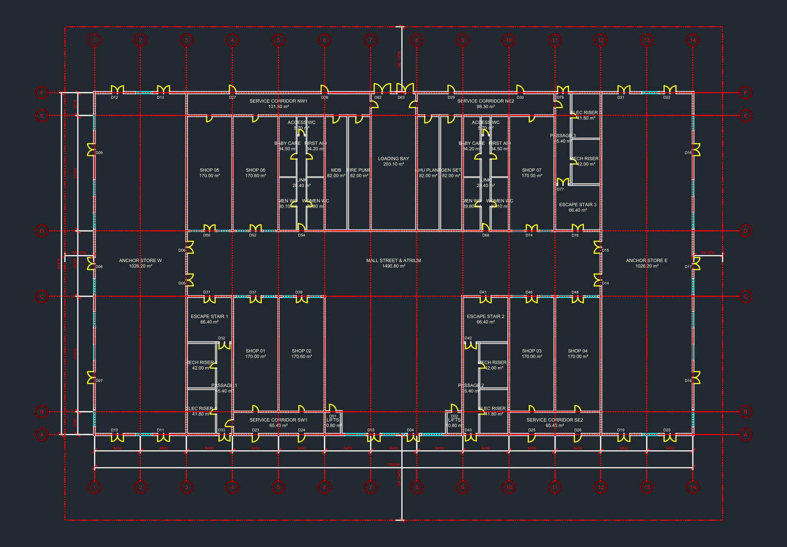 | 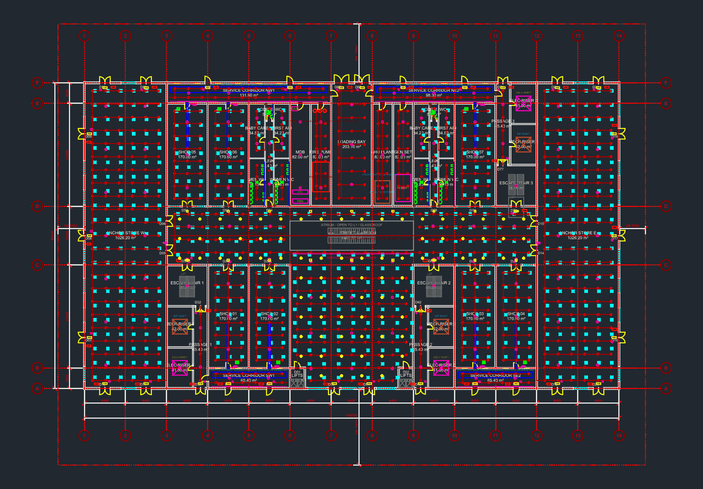 |

| Item | Value used | Source / status |
|---|---|---|
| Travel distance to exit (sprinklered) | <= 45 m; computed max GF 42.1 m, L1 42.1 m; stairs per level 3; exterior exit doors GF 29 | uk.md 5.2 AD B Table 2.1 shops, more than one direction 45 m ⚠ verify |
| Setbacks front / side / rear | 5 / 3 / 3 m (sheet code check: PASS) | ASSUMED 5/3/3 m - no commercial-zone setbacks in country file ⚠ verify |
| Escape stair / exit route clear width | >= 1000 mm (doors, passages, corridors) | uk.md 5.2 escape stair >= 1000 mm ⚠ verify |
| Parking | required 264 bays (GLA 6593 m2 / 25 m2 per bay); 45 surface bays drawn as ground massing | rule of thumb 4 bays per 100 m2 GLA ⚠ verify; balance not modelled |
| GF height | 5000 mm | rule of thumb 4.5-5.5 m GF floor-to-floor ⚠ verify |
| Sprinklers | EN 12845 OH: <= 12.0 m2 and 4 m per head | references/disciplines/mep.md 4.1; grid 2.8 m is RoT |
| plan_audit | GF: 7 pass / 0 warn / 0 fail; L1: 7 pass / 0 warn / 0 fail | scripts/plan_audit.py |
| Files | GF-MEP.png, GF-audit.txt, GF-plan.png, GF.json, L1-audit.txt, L1.json, dxf-ifc.zip, ifc.txt, mall.json | |

### us

**United States** - sheet 1/16" = 1'-0", floor-to-floor GF 5000 mm / upper 4500 mm, footprint 109.2 x 62.4 m on a 120 x 90 m plot (coverage 63.1 %).

| Plan GF | MEP GF | Render (3ds Max ART) |
|---|---|---|
| 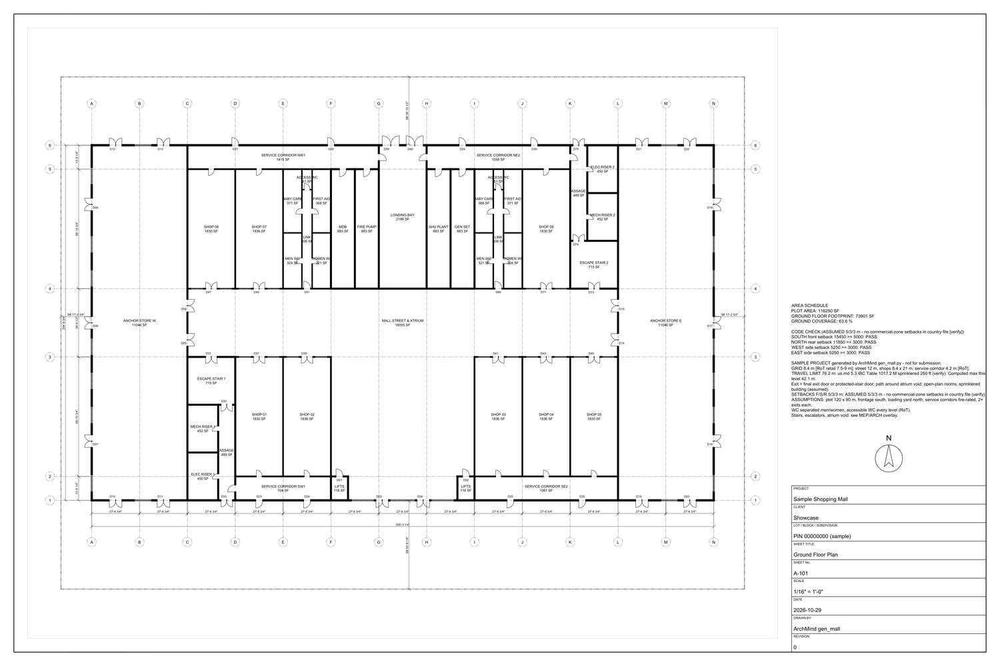 | 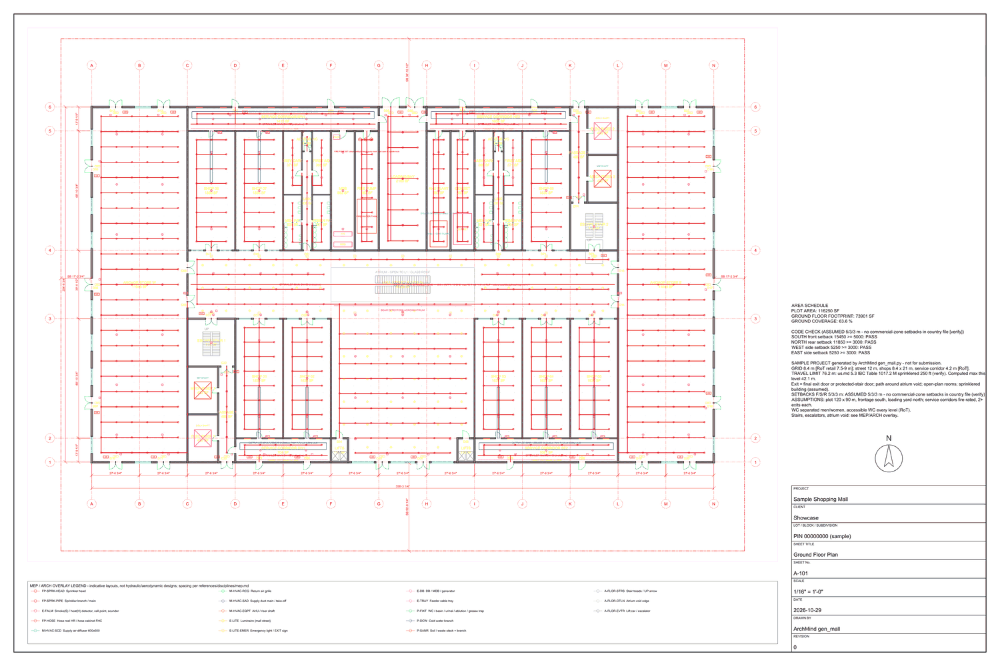 |  |

| Item | Value used | Source / status |
|---|---|---|
| Travel distance to exit (sprinklered) | <= 76.2 m; computed max GF 42.1 m, L1 51.6 m; stairs per level 2; exterior exit doors GF 28 | us.md 5.3 IBC Table 1017.2 M sprinklered 250 ft ⚠ verify |
| Setbacks front / side / rear | 5 / 3 / 3 m (sheet code check: PASS) | ASSUMED 5/3/3 m - no commercial-zone setbacks in country file ⚠ verify |
| Escape stair / exit route clear width | >= 1118 mm (doors, passages, corridors) | us.md 5.3 IBC 1011.2 commercial stair 44 in ✓ |
| Parking | required 299 bays (GLA 6935 m2 / 23.2 m2 per bay); 45 surface bays drawn as ground massing | us.md 5.5 retail 1 per 250 sq ft ⚠ verify; balance not modelled |
| GF height | 5000 mm | rule of thumb 4.5-5.5 m GF floor-to-floor ⚠ verify |
| Sprinklers | NFPA 13 OH2: <= 12.1 m2 and 4.6 m per head | references/disciplines/mep.md 4.1; grid 2.8 m is RoT |
| plan_audit | GF: 7 pass / 0 warn / 0 fail; L1: 7 pass / 0 warn / 0 fail | scripts/plan_audit.py |
| AutoCAD 2026 (accoreconsole, `acad_verify.py`) | GF.dxf: AUDIT_ERRORS=0, ON_LAYER_0=0, layers 14, entities 1271; GF-MEP.dxf: AUDIT_ERRORS=0, ON_LAYER_0=0, layers 37, entities 6782; DWG + PDF written; PNG previews are made from the AutoCAD PDF | verified |
| Files | GF-MEP-report.txt, GF-MEP.dwg, GF-MEP.pdf, GF-MEP.png, GF-audit.txt, GF-plan.png, GF-report.txt, GF.dwg, GF.dxf, GF.ifc, GF.json, GF.pdf, L1-audit.txt, L1.json, extra-dxf.zip, ifc.txt, mall.json, render.jpg | |

### za

**South Africa** - sheet 1:250 @ A1, floor-to-floor GF 5000 mm / upper 4500 mm, footprint 109.2 x 62.4 m on a 120 x 90 m plot (coverage 63.1 %).

| Plan GF | MEP GF |
|---|---|
|  |  |

| Item | Value used | Source / status |
|---|---|---|
| Travel distance to exit (sprinklered) | <= 45 m; computed max GF 42.1 m, L1 42.1 m; stairs per level 3; exterior exit doors GF 29 | default 45 m sprinklered - number not in country file (verify with authority) ⚠ verify |
| Setbacks front / side / rear | 5 / 3 / 3 m (sheet code check: PASS) | ASSUMED 5/3/3 m - no commercial-zone setbacks in country file ⚠ verify |
| Escape stair / exit route clear width | >= 1200 mm (doors, passages, corridors) | rule of thumb 1200 mm clear ⚠ verify |
| Parking | required 264 bays (GLA 6593 m2 / 25 m2 per bay); 45 surface bays drawn as ground massing | rule of thumb 4 bays per 100 m2 GLA ⚠ verify; balance not modelled |
| GF height | 5000 mm | rule of thumb 4.5-5.5 m GF floor-to-floor ⚠ verify |
| Sprinklers | NFPA 13 OH2: <= 12.1 m2 and 4.6 m per head | references/disciplines/mep.md 4.1; grid 2.8 m is RoT |
| plan_audit | GF: 7 pass / 0 warn / 0 fail; L1: 7 pass / 0 warn / 0 fail | scripts/plan_audit.py |
| Files | GF-MEP.png, GF-audit.txt, GF-plan.png, GF.json, L1-audit.txt, L1.json, dxf-ifc.zip, ifc.txt, mall.json | |

## Known weaknesses

- Sample layouts on a fixed 120 x 90 m plot give few shops per level (7-8 on GF, plus 4 food units on L1); larger plots (`--plot 160x110`) give more bays.
- Setbacks, coverage and parking are assumptions wherever the country file has no commercial-zone number (flagged); parking is surface massing only.
- Travel-distance model: open-plan rooms, centre-line geometry, protected-stair door = exit, sprinklered building; not a fire-engineering study.
- Stairs, lifts and escalators are symbols in the MEP/arch overlay only (the plain plan DXF has no stair geometry); IFC holds walls, doors, windows, spaces and slabs only.
- MEP overlay is symbol-level and indicative (no pipe/duct sizing, circuiting, riser diagrams). Room labels in 4 m wide rooms can overlap at 1:250.
- Room names are English except Arabic on Arabic-profile countries; Chinese/Japanese profile layer names are used as-is.
