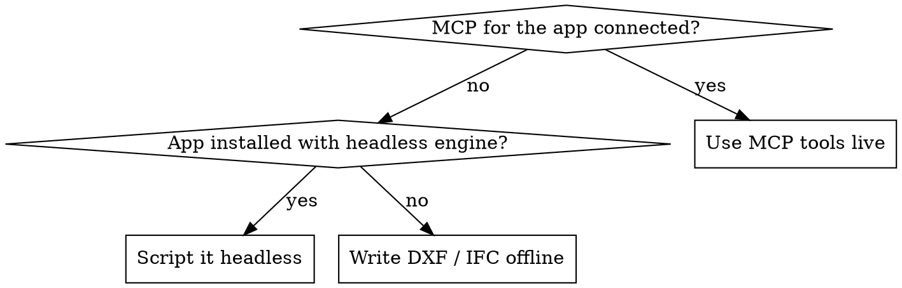

# ArchMind — Architecture · MEP · BIM

Drawings get rejected for jurisdiction reasons, not geometry. **Pin the country and the plot before drawing anything; take every code number from the references with its citation; verify the output in the real app before calling it done.**

## 1. Pin the jurisdiction first

Collect before any geometry (ask in one message; never guess these):

| Input | Why it changes the drawing |
|---|---|
| Country + city/municipality (+ zone or community) | Code, authority, units, layer and title-block practice |
| Plot no., plot size, street width(s) and which sides front streets | Setbacks, height and coverage are set by zone and street width |
| Use + type (villa, apartments, office…) + floors, basement, roof use | Which tables apply |
| Who submits (authority / e-permit system) | Sheet list, DWG version, coordinate system |

If the user can't answer, proceed and put an **ASSUMPTIONS** note on the drawing listing every guessed input (unknown frontage → assume one street on the entrance side, all other sides neighbours).

## 2. Load only the references you need

| Need | File |
|---|---|
| Country drafting + code numbers | `references/countries/<iso2>.md` (us uk qa ae sa eg kw om bh jo ma tr de fr es it in cn jp sg au pk my ca mx br za ng — whichever exist) |
| Any other country | `references/countries/_world-index.md` → its code family → nearest family file, and say the National Annex/local amendments differ |
| How a discipline's drawings are made | `references/disciplines/` architecture, structural, mep, mep-shop-drawings, civil-site |
| Concept, typology, climate, precedents | `references/disciplines/design-concepts.md` |
| How buildings are physically built there (structure, wall/roof build-ups, sequence, MEP practice) | `references/disciplines/construction-methods.md` |
| Software workflow, scripting, MCP | `references/software/` autocad, autocad-mep-electrical-mechanical, revit, sketchup, 3dsmax, ifc-openbim |

## 3. Code numbers

- Quote a number only from the country file, with its source (code + section/edition or decision no.).
- A number marked ⚠ in the file goes out as "verify with <authority>", never as fact.
- A number not in the file: say it is missing and name where to check. **Never invent a law, decision or section number.** Some limits are never national (US zoning, Egyptian site-suitability statement, plot affection plans): name the document the client must obtain.
- Put the limits you cited into the spec's `rules` (with `source`); `dxf_plan.py` then prints a PASS/FAIL code check for setbacks and coverage on the sheet. A FAIL is a design problem to fix, not a note to leave.

## 4. Choose the output route



- Revit **LT** has no API: no add-ins, Dynamo, pyRevit or revit-mcp. Deliver IFC/DWG for import instead.
- Headless engines: AutoCAD `accoreconsole.exe` (not in AutoCAD LT), 3ds Max `3dsmaxbatch.exe`, Blender `blender -b`, SketchUp `SketchUp.exe -RubyStartup`.

```bash
uv run --with ezdxf scripts/dxf_plan.py plan.json        # country-correct plan DXF (see --help for spec)
uv run scripts/acad_verify.py plan.dxf --layout A1-GF    # real AutoCAD: AUDIT, DWG, PDF, report
uvx --with matplotlib ezdxf draw -o preview.png plan.dxf # quick preview without AutoCAD
```

BIM from the same spec (Revit incl. LT, ArchiCAD, Bonsai import it; walls typed, openings are real voids, validated):
`uv run --with ifcopenshell scripts/ifc_from_spec.py plan.json`

3D + render from the same spec (3ds Max, site sun from `BS_LAT/BS_LON/BS_TZ`): set `BS_SPEC` and `BS_OUT`, then run `3dsmaxbatch.exe scripts\max_massing.py` (details in the script header). Use ART, not Arnold, in batch: Arnold watermarks when its licence doesn't start.

## Full projects: run the agent team

When installed as a Claude Code plugin, the repo's `agents/` gives one specialist per stage. For anything bigger than a single sheet, dispatch them in order and feed each one the previous output: `aec-brief-planner` → `aec-code-checker` (loop back to the planner until 0 FAIL) → `aec-drafter` → `aec-mep-engineer` → `aec-bim-modeler` → `aec-visualizer` → `aec-qa-reviewer`. Without the plugin, run the same stages yourself in that order.

## 5. Set the drawing up the country's way

`scripts/profiles/<iso2>.json` holds units, dimension format, layers, sheet and bilingual title block (qa eg sa ae us uk; `"extends"` makes a new one from the nearest). Without a profile, build one from sections 1–3 of the country file. A correct setup has all of:

INSUNITS · text style on a TrueType font that covers Arabic (Arial/Tahoma) · dimension style per scale in the country's format · layers per the country's standard · paper-space layout with the viewport at true scale · title block fields from the country file · north arrow · grids · plot boundary with setback dimensions · area schedule · notes.

The spec's `plot`, `rules`, `notes` and `profile` keys produce the last three and per-drawing overrides; run `dxf_plan.py --help` for the full format. Pick scale and sheet so the plan fills at least half the sheet: a small villa is `"profile": {"scale": 50, "scale_label": "1:50 @ A1"}`, not 1:100 on A1.

## 6. Arabic and bilingual text

AutoCAD shapes Arabic letters but lays words out left-to-right, so phrases read backwards. Reverse word order (`dxf_plan.py` does it), use MTEXT with a TrueType font, Western digits, and check the plotted PDF. Neutral characters (`-`, `/`, `:`, brackets, digits) inside an Arabic phrase land in unpredictable places: keep Arabic labels to words only and put numbers or codes on their own line or in the English text.

## 7. Verify before saying done

0. `uv run --with shapely --with networkx scripts/plan_audit.py plan.json` (rooms, circulation, door placement, light, privacy, minimum sizes): fix every FAIL in the design before drawing/exporting; review WARNs.
1. `acad_verify.py` (or the app itself): `AUDIT_ERRORS=0` (otherwise read `<name>-acad.log`), `ON_LAYER_0=0`, DWG and PDF written. Paper names for each sheet size are in its `--help`.
2. Render the PDF to PNG and look: tag/dimension collisions, door swings into the room they serve, Arabic order, scale.
3. Checklist: setbacks dimensioned to every boundary · area schedule (plot, footprint, coverage %, FAR) · room names + areas · door/window tags · levels · scale + north · title block complete · revision.
4. Report what was not verified.

## Common mistakes

| Mistake | Fix |
|---|---|
| Same US/NCS layers and units for every country | Load the country profile and file |
| Guessing setbacks/coverage | Ask zone + street width; cite the table |
| Citing a law number from memory | Only cite what the country file lists |
| DXF with layers only | Full setup per section 5 |
| Egypt plans dimensioned in mm | Egypt uses cm on plans, m for levels |
| US dims in decimal inches | Feet-inches text (`12'-6"`) |
| Saudi municipal plans in mm | Metres to 2 decimals |
| "Done" without opening the file | Section 7 |
